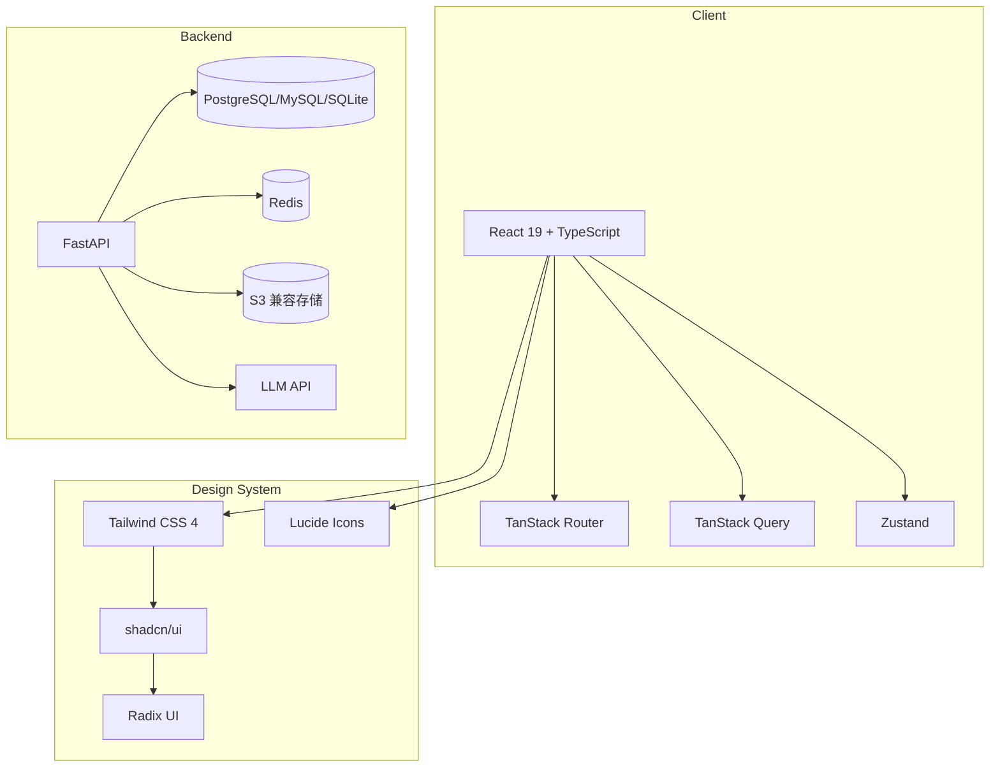

# PaperSage 项目文档

> PaperSage - AI辅助学术论文写作系统

## 文档概述

本文档全面描述 PaperSage 项目的背景、设计、实现、测试和部署。PaperSage 是一款面向科研新手（本科生、研究生）的 AI 辅助学术论文写作 Web 应用，旨在降低学术写作门槛，提升写作效率和质量。

## 文档结构

```text
docs/
├── PROJECT.md                    # 本文档 - 项目总览
├── DEFINITION.md                 # 课题简介
├── project/
│   ├── 01-background.md         # 项目背景与需求分析
│   ├── 02-requirements.md       # 功能需求规格
│   ├── 03-architecture.md       # 系统架构设计
│   ├── 04-frontend.md           # 前端实现详情
│   ├── 05-backend.md            # 后端设计规格
│   ├── 06-database.md           # 数据库设计
│   ├── 07-api.md                # API 接口规格
│   ├── 08-workflows.md          # 业务流程图
│   ├── 09-testing.md            # 测试策略
│   ├── 10-deployment.md         # 部署运维
│   └── 11-roadmap.md            # 开发路线图
├── frontend/                    # 前端迁移计划
└── backend/                     # 后端设计文档
    ├── DESIGN.md
    ├── PLANS.md
    ├── TODOS.md
    ├── RELIABILITY.md
    ├── SECURITY.md
    └── DEPLOYMENT.md
```

## 快速导航

| 章节 | 描述 | 适合人群 |
|------|------|----------|
| [背景与需求](project/01-background.md) | 项目背景、痛点分析、目标用户 | 项目经理、架构师 |
| [功能需求](project/02-requirements.md) | 功能规格、非功能需求 | 产品经理、开发人员 |
| [系统架构](project/03-architecture.md) | 整体架构、技术选型、组件设计 | 架构师、技术负责人 |
| [前端实现](project/04-frontend.md) | 前端技术栈、目录结构、核心模块 | 前端开发人员 |
| [后端设计](project/05-backend.md) | 后端架构、API 设计、安全方案 | 后端开发人员 |
| [数据库设计](project/06-database.md) | 表结构、ER 图、数据字典 | 数据库设计师 |
| [API 规格](project/07-api.md) | 接口定义、请求响应格式 | 前后端开发人员 |
| [业务流程](project/08-workflows.md) | 用户流程、泳道图、时序图 | 产品经理、测试人员 |
| [测试策略](project/09-testing.md) | 测试方案、覆盖率目标 | 测试工程师 |
| [部署运维](project/10-deployment.md) | Docker、环境配置、监控 | 运维工程师 |
| [开发路线](project/11-roadmap.md) | 版本计划、里程碑 | 项目经理 |

## 技术概览

> **重要**: 系统已抽象化设计，支持多数据库和 S3 兼容存储

### 数据抽象

| 组件 | 支持选项 | 说明 |
|------|----------|------|
| 数据库 | PostgreSQL, MySQL, SQLite | 通过 SQLAlchemy 异步驱动自动适配 |
| 对象存储 | MinIO, AWS S3, 阿里云 OSS | 使用 S3 标准 API 兼容 |



## 核心特性

### 已实现 (Frontend MVP)

- [x] 用户认证（登录/注册）
- [x] 项目列表管理
- [x] 项目创建/删除/分组
- [x] 回收站功能
- [x] 项目工作空间框架

### 开发中

- [ ] 上传模块（PDF/Word 参考文献 + LaTeX 模板）
- [ ] 编码/标注模块
- [ ] 分类模块（占位）
- [ ] 逻辑链模块（占位）
- [ ] 生成模块（占位）
- [ ] LaTeX 编辑器

### 规划中

- [ ] AI 写作辅助
- [ ] 学术规范资源库
- [ ] 全文检索
- [ ] 多文件 LaTeX 编译
- [ ] 参考文献集成

## 快速开始

### 前端开发

```bash
cd frontend
pnpm install
pnpm dev
```

### 后端开发（待实现）

```bash
cd backend
cp .env.example .env
# 配置数据库和 Redis
docker-compose up -d
uvicorn app.main:app --reload
```

## 相关资源

- [前端迁移计划](frontend/2026-03-27-frontend-migration-plan.md)
- [后端设计文档](backend/DESIGN.md)
- [CLAUDE.md](../../CLAUDE.md) - 开发规范

---

*本文档随项目迭代持续更新，最后更新于 2026-04-07*