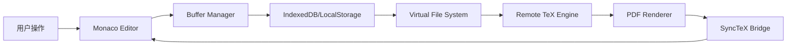

# LaTeX 论文编辑系统设计文档 (PaperSage LaTeX System Design)

## 1. 概述
本文档定义了 PaperSage LaTeX 编辑系统的核心架构、接口规范及技术实现方案。系统的目标是提供一个专业、流畅且具备 AI 增强能力的在线 LaTeX 创作环境，支持多文件管理、实时编译预览及 SyncTeX 精准同步。

## 2. 系统架构 (Architecture)

系统采用典型的 **“编辑器 - 虚拟文件系统 - 编译微服务 - 预览器”** 四层架构。

### 2.1 状态流程图


---

## 3. 接口规范 (API Interface)

### 3.1 文件系统 (FileSystem)
用于管理项目内的源码及静态资源。

#### 获取项目完整文件树
- **Endpoint**: `GET /api/v1/projects/{projectId}/files`
- **Response**: `ProjectTree`

#### 文件操作
- `POST /api/v1/files`: 创建或上传文件（支持 Multipart）
- `PUT /api/v1/files/{fileId}`: 更新文件内容（支持部分更新/增量同步建议）
- `DELETE /api/v1/files/{fileId}`: 删除文件

---

### 3.2 编译引擎 (Compilation)
采用异步任务队列处理，支持长耗时编译。

#### 提交编译任务
- **Endpoint**: `POST /api/v1/compile`
- **Request**:
```typescript
{
  projectId: string;
  mainFileId: string;
  engine: 'pdflatex' | 'xelatex' | 'lualatex';
}
```

---

## 4. 关键技术实现

### 4.1 智能大纲提取 (Outline Parsing)
由于 LaTeX 语法复杂，采用正则表达式 + 深度优先遍历在 Web Worker 中提取结构。

### 4.2 增量编译优化 (Incremental Compilation)
1. **Hash 校验**：前端计算各文件 MD5，仅上传 Hash 变化的文件。
2. **持久化工作区**：后端编译器保留 `.aux`, `.log`, `.bbl` 等文件。

---

## 5. 持久化与同步策略 (Persistence & Sync)

这是确保用户数据安全的核心层。

### 5.1 三级持久化架构
1.  **L1: Buffer (内存)**: Monaco Editor 内部状态，实时响应输入。
2.  **L2: Local Cache (浏览器本地)**:
    *   使用 **IndexedDB** (推荐 Dexie.js) 存储每个文件的“脏数据（Dirty Drafts）”。
    *   **触发时机**: 每次键盘停顿后 500ms 自动写入本地。
    *   **作用**: 即使浏览器意外关闭或突然掉电，重启后可从本地恢复。
3.  **L3: Remote Origin (云端)**:
    *   **自动保存**: 采用节流（Throttle）策略，每隔 30 秒或用户点击“编译”时，将改动同步至后端。
    *   **冲突检测**: 基于 `updated_at` 时间戳进行乐观锁控制，防止多端编辑覆盖。

### 5.2 离线保护机制 (Offline Protection)
*   **网络检测**: 监听 `online/offline` 事件。离线时，UI 顶部显示“未连接，数据将保存在本地”。
*   **断点续传**: 网络恢复后，自动对比本地 IndexedDB 与云端版本，引导用户合并或覆盖。

### 5.3 静态资源持久化
*   图片等二进制资源在上传后由后端 S3/OSS 存储，前端 VFS 缓存其 URL，避免重复上传。

---

## 6. 待办事项 (Roadmap)
- [ ] **IndexedDB 集成**: 引入 Dexie.js 管理本地文件草稿。
- [ ] **自动保存引擎**: 开发支持节流与冲突检测的云端同步逻辑。
- [ ] 实现前端 LaTeX 结构解析 Web Worker。
- [ ] 开发集成 SyncTeX 数据解析的 PDF 交互层组件。
- [ ] 构建支持 Docker 镜像隔离的后端 LaTeX 编译任务调度器。
