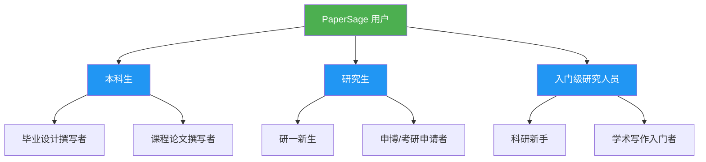
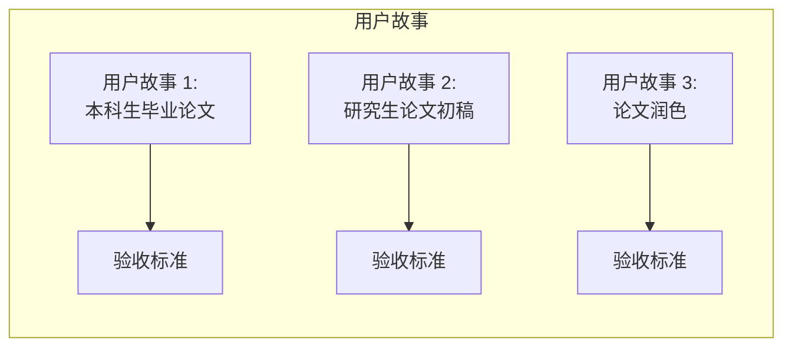
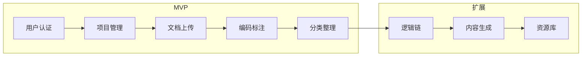

# 项目背景与需求分析

## 1. 项目背景

### 1.1 课题背景

学术论文写作是本科生完成毕业设计、研究生开启科研生涯的核心必备能力，也是检验专业知识应用、科研思维与逻辑表达能力的核心标准。然而，对于广大科研新手而言，学术写作往往是一件令人望而生畏的任务。

### 1.2 问题陈述

本科生与刚接触科研的研究生作为学术写作的核心新手群体，普遍面临着以下共性痛点：

| 痛点 | 描述 | 影响 |
|------|------|------|
| **经验不足** | 多为首次接触规范化学术写作，对学术写作规范与核心方法缺乏系统认知 | 无从下手，格式不规范 |
| **能力短板** | 专业写作能力不足，不熟悉文献综述、研究方法、学术表达 | 写作效率低，质量不高 |
| **指导稀缺** | 导师时间有限，重复性的基础指导工作负担重 | 学生获得反馈周期长 |
| **工具缺失** | 缺乏专门的学术写作辅助工具 | 写作过程孤立无援 |

### 1.3 技术机遇

大语言模型（LLM）凭借成熟的自然语言理解、逻辑梳理、规范文本生成与优化能力，为破解科研新手的写作入门痛点提供了可行的技术路径：

- **自然语言理解**：理解用户的写作意图和需求
- **逻辑梳理**：帮助组织和优化论文结构
- **文本生成**：辅助生成规范的学术内容
- **质量优化**：提供写作建议和改进方案

### 1.4 项目目标

利用大模型为学生群体提供全流程的写作引导与辅助，既能：

1. **降低门槛** - 有效降低学术写作的入门门槛
2. **规范流程** - 规范写作流程，提供结构化指导
3. **提升质量** - 提升文本质量与创作效率
4. **减轻负担** - 帮助学生聚焦核心研究内容的打磨，同时减轻导师重复性的基础指导工作

## 2. 目标用户

### 2.1 主要用户群体

### 2.2 用户特征

| 用户类型 | 特征 | 需求优先级 |
|----------|------|------------|
| 本科生 | 首次接触学术写作，缺乏经验，时间紧张 | 格式规范 > 结构指导 > 内容生成 |
| 研究生 | 有一定基础，需要深入指导，科研压力大 | 效率提升 > 质量优化 > 创新建议 |
| 入门级研究人员 | 刚进入科研领域，需要系统性帮助 | 全面辅助 > 规范检查 > AI 写作 |

### 2.3 用户故事

#### 用户故事 1：本科生毕业论文
**角色**：即将毕业的大学生

**需求**：我希望有一个工具帮助我了解学术论文的格式规范

**价值**：以便我能够正确地完成毕业论文的写作

**验收标准**：
- [ ] 提供毕业论文格式规范模板
- [ ] 支持常见学科的格式检查
- [ ] 给出格式修改建议

#### 用户故事 2：研究生论文初稿
**角色**：研一新生

**需求**：我希望能够上传我的课程论文并获得 AI 反馈

**价值**：以便我了解自己的写作水平和改进方向

**验收标准**：
- [ ] 支持 PDF/Word 文档上传
- [ ] 提供写作质量评估报告
- [ ] 给出具体改进建议

#### 用户故事 3：论文润色
**角色**：忙碌的研究生

**需求**：我希望快速获得论文的语法和表达优化建议

**价值**：以便我有更多时间专注于研究内容本身

**验收标准**：
- [ ] 提供语法错误检测
- [ ] 给出表达优化建议
- [ ] 支持一键批量优化

## 3. 业务背景

### 3.1 现有解决方案分析

| 方案类型 | 代表产品 | 优点 | 缺点 |
|----------|----------|------|------|
| 通用 AI 聊天 | ChatGPT, Claude | 功能全面 | 缺乏学术场景优化 |
| 论文查重 | Turnitin, 知网 | 检测准确 | 仅检测，无辅助 |
| 论文润色 | Grammarly, QuillBot | 英文润色 | 主要面向英文 |
| 写作平台 | Overleaf, 腾讯文档 | 协作功能 | 无 AI 辅助 |

### 3.2 市场机会

1. **垂直领域空白**：针对中文学术写作的 AI 辅助工具市场仍有许多待开发空间
2. **场景化需求强**：学术写作有明确的流程和规范，非常适合 AI 辅助
3. **用户基数大**：中国每年有大量本科生和研究生需要完成学术论文写作

### 3.3 竞争壁垒

1. **专属 Prompt 优化**：针对本科生毕设、入门级学术论文等场景的定制化提示词
2. **全流程覆盖**：从选题到成稿的完整写作流程支持
3. **学术规范资源**：内置丰富的学术规范和模板资源

## 4. 项目范围

### 4.1 MVP 范围（第一阶段）

### 4.2 核心功能模块

| 模块 | 功能描述 | 优先级 |
|------|----------|--------|
| 用户管理 | 注册、登录、会话管理 | P0 |
| 项目管理 | 创建、删除、归组项目 | P0 |
| 文档上传 | PDF/Word 上传、文件夹管理 | P0 |
| 编码标注 | PDF 预览、文本高亮、批注 | P0 |
| 论文分类 | 文献分类、标签管理 | P1 |
| 逻辑链构建 | 论文结构梳理 | P1 |
| AI 生成 | 大纲生成、内容生成、润色 | P2 |
| 资源库 | 学术规范、模板、范例 | P2 |

### 4.3 边界说明

**在范围内**：
- Web 端应用（响应式设计，支持移动端查看）
- 中文界面
- 主流文档格式支持（PDF 优先）

**不在范围内**：
- 移动端原生应用
- 英文及其他语言界面
- 复杂格式文档编辑
- 离线客户端

## 5. 假设与约束

### 5.1 技术假设

1. 后端 API 服务可通过 Docker 部署
2. 大模型 API（OpenAI/Claude 等）可正常访问
3. 用户设备支持现代浏览器（Chrome 90+, Edge 90+, Firefox 90+, Safari 15+）

### 5.2 业务约束

1. MVP 阶段专注于核心功能，不追求大而全
2. UI/UX 采用渐进式增强策略
3. 优先保证系统稳定性和数据安全

### 5.3 时间约束

- 前端迁移：持续进行中
- 后端开发：按优先级分阶段实现
- 完整版发布：视开发进度而定

---

*本文档定义了 PaperSage 项目的背景和需求分析，是后续所有设计工作的基础。*