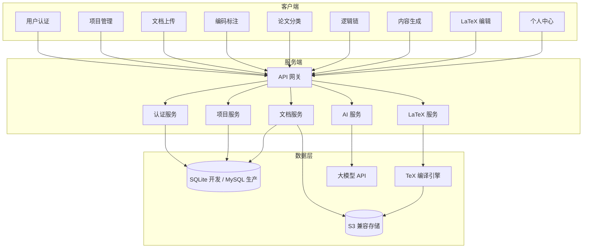
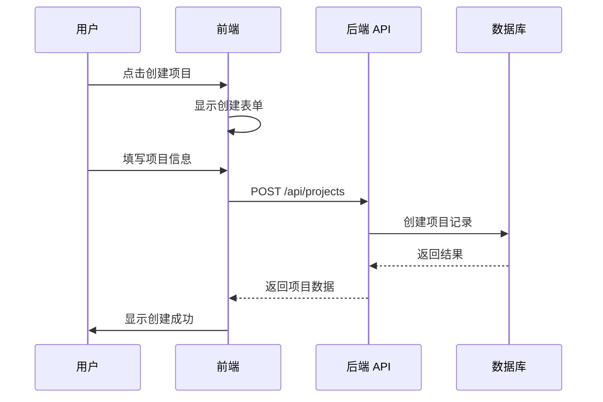
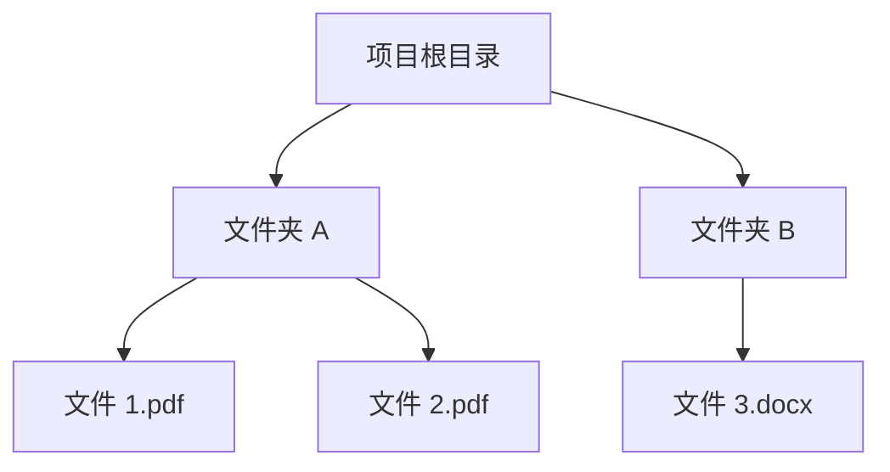
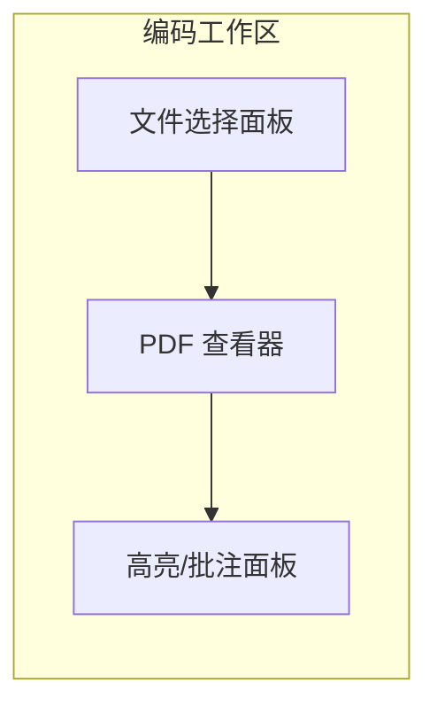
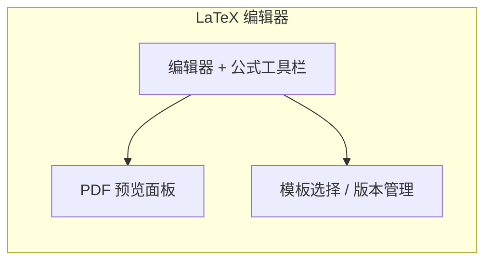
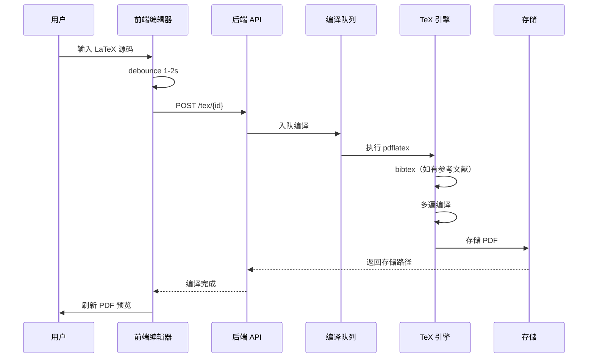

# 功能需求规格

## 1. 功能需求概述

本章详细描述 PaperSage 系统的功能需求，包括核心业务功能、用户交互流程和接口规格。

### 1.1 功能模块总览



## 2. 用户认证模块

### 2.1 功能描述

用户认证模块负责用户的注册、登录和会话管理。

### 2.2 功能需求

| 需求编号 | 描述 | 优先级 | 备注 |
|----------|------|--------|------|
| AUTH-001 | 用户可以使用用户名和密码注册账户 | P0 | 需要邮箱验证（可选） |
| AUTH-002 | 用户可以使用用户名和密码登录系统 | P0 | |
| AUTH-003 | 登录成功后返回 Access Token 和 Refresh Token | P0 | |
| AUTH-004 | Access Token 过期后可使用 Refresh Token 刷新 | P0 | |
| AUTH-005 | 用户可以退出登录，清除会话 | P0 | |
| AUTH-006 | 登录页面需要图片验证码（可选） | P1 | 防暴力破解 |

### 2.3 数据需求

```typescript
// 注册请求
interface RegisterRequest {
  username: string;      // 用户名，3-20字符
  password: string;      // 密码，MD5 加密传输
  email?: string;        // 邮箱（可选）
}

// 登录请求
interface LoginRequest {
  username: string;
  password: string;      // MD5 加密
  captcha?: string;      // 验证码（可选）
}

// 登录响应
interface LoginResponse {
  accessToken: string;
  refreshToken: string;
  user: {
    id: string;
    username: string;
    email?: string;
  };
}

// 刷新 Token 请求
interface RefreshTokenRequest {
  refreshToken: string;
}
```

### 2.4 业务规则

1. 用户名必须唯一
2. 密码传输使用 MD5 加密（向后兼容）
3. Access Token 有效期：30 分钟
4. Refresh Token 有效期：7 天
5. 同一账号最多同时在线 3 个设备

## 3. 项目管理模块

### 3.1 功能描述

项目管理模块负责项目的创建、编辑、删除和归组操作。

### 3.2 功能需求

| 需求编号 | 描述 | 优先级 | 备注 |
|----------|------|--------|------|
| PROJ-001 | 用户可以创建新项目 | P0 | |
| PROJ-002 | 用户可以查看项目列表 | P0 | 支持分组筛选 |
| PROJ-003 | 用户可以编辑项目名称 | P0 | |
| PROJ-004 | 用户可以删除项目 | P0 | 进入回收站 |
| PROJ-005 | 用户可以创建项目分组 | P0 | |
| PROJ-006 | 用户可以将项目移动到分组 | P0 | |
| PROJ-007 | 用户可以搜索项目 | P1 | 按名称模糊搜索 |
| PROJ-008 | 用户可以查看项目详情 | P0 | |

### 3.3 数据模型

```typescript
// 项目
interface Project {
  id: string;
  name: string;
  description?: string;
  groupId?: string;
  status: 'active' | 'archived';
  createdAt: string;
  updatedAt: string;
  createdBy: string;
}

// 项目分组
interface ProjectGroup {
  id: string;
  name: string;
  userId: string;
  createdAt: string;
  order: number;
}
```

### 3.4 业务流程



## 4. 文档上传模块

### 4.1 功能描述

文档上传模块负责文件的批量上传、文件夹管理和文件预览。

### 4.2 功能需求

| 需求编号 | 描述 | 优先级 | 备注 |
|----------|------|--------|------|
| UPLOAD-001 | 用户可以上传 PDF/Word 参考文献 | P0 | 支持大文件分片 |
| UPLOAD-002 | 用户可以上传 LaTeX 模板文件 | P1 | .tex 导入 |
| UPLOAD-003 | 用户可以创建文件夹 | P0 | |
| UPLOAD-004 | 用户可以查看文件夹树形结构 | P0 | |
| UPLOAD-005 | 用户可以移动文件/文件夹 | P0 | |
| UPLOAD-006 | 用户可以重命名文件/文件夹 | P0 | |
| UPLOAD-007 | 用户可以删除文件/文件夹 | P0 | 进入回收站 |
| UPLOAD-008 | 用户可以预览 PDF 文件 | P0 | |
| UPLOAD-009 | 用户可以添加文件备注 | P0 | |
| UPLOAD-010 | 显示上传进度 | P0 | 支持断点续传 |

### 4.3 数据模型

```typescript
// 文件夹
interface Folder {
  id: string;
  projectId: string;
  parentId?: string;
  name: string;
  createdAt: string;
  updatedAt: string;
}

// 文件
interface Document {
  id: string;
  projectId: string;
  folderId?: string;
  name: string;
  type: 'pdf' | 'word' | 'other';
  size: number;
  storageKey: string;
  remark?: string;
  status: 'processing' | 'ready' | 'error';
  createdAt: string;
  updatedAt: string;
}
```

### 4.4 文件夹树结构



## 5. 编码标注模块

### 5.1 功能描述

编码标注模块是论文阅读和批注的核心功能，支持 PDF 预览、高亮和批注。

### 5.2 功能需求

| 需求编号 | 描述 | 优先级 | 备注 |
|----------|------|--------|------|
| CODE-001 | 用户可以在 PDF 上选择文本 | P0 | |
| CODE-002 | 用户可以为选中文本添加高亮 | P0 | 多种颜色 |
| CODE-003 | 用户可以为选中文本添加批注 | P0 | |
| CODE-004 | 用户可以查看和管理高亮列表 | P0 | 侧边栏面板 |
| CODE-005 | 用户可以导出高亮内容 | P1 | |
| CODE-006 | 支持多文件标签页切换 | P0 | |
| CODE-007 | PDF 翻页和缩放功能 | P0 | |

### 5.3 数据模型

```typescript
// 高亮
interface Highlight {
  id: string;
  documentId: string;
  userId: string;
  page: number;
  content: string;
  color: 'yellow' | 'green' | 'blue' | 'pink' | 'orange';
  note?: string;
  position: {
    x: number;
    y: number;
    width: number;
    height: number;
  };
  createdAt: string;
}

// 批注
interface Annotation {
  id: string;
  highlightId: string;
  content: string;
  createdAt: string;
  updatedAt: string;
}
```

### 5.4 界面布局



## 6. 论文分类模块

### 6.1 功能描述

论文分类模块帮助用户对文献进行分类管理，支持标签和分类体系。

### 6.2 功能需求

| 需求编号 | 描述 | 优先级 | 备注 |
|----------|------|--------|------|
| CLASS-001 | 用户可以为文档添加标签 | P1 | |
| CLASS-002 | 用户可以按标签筛选文档 | P1 | |
| CLASS-003 | 用户可以创建自定义分类体系 | P1 | |
| CLASS-004 | 系统提供预设分类模板 | P1 | 如：研究方法、文献类型等 |

## 7. 逻辑链模块

### 7.1 功能描述

逻辑链模块帮助用户梳理论文结构和论证逻辑。

### 7.2 功能需求

| 需求编号 | 描述 | 优先级 | 备注 |
|----------|------|--------|------|
| LOGIC-001 | 用户可以创建论文大纲 | P1 | |
| LOGIC-002 | 用户可以将高亮内容关联到大纲节点 | P1 | |
| LOGIC-003 | 支持思维导图式展示 | P1 | |
| LOGIC-004 | 支持导出结构化文档 | P1 | |

## 8. 内容生成模块

### 8.1 功能描述

内容生成模块利用 AI 能力辅助用户生成论文内容。

### 8.2 功能需求

| 需求编号 | 描述 | 优先级 | 备注 |
|----------|------|--------|------|
| GEN-001 | 基于上传文献生成摘要 | P1 | |
| GEN-002 | 生成论文大纲建议 | P1 | |
| GEN-003 | 基于大纲生成正文内容 | P1 | |
| GEN-004 | 提供写作风格建议 | P1 | |
| GEN-005 | 语法和表达润色 | P1 | |
| GEN-006 | AI 生成内容可一键填入 LaTeX 模板 | P1 | |

### 8.1 LaTeX 编辑模块

#### 8.1.1 功能描述

LaTeX 编辑模块提供 LaTeX 文档编辑和编译功能，用户可以在 PaperSage 中完成从文献阅读到论文输出的完整流程。

#### 8.1.2 功能需求

| 需求编号 | 描述 | 优先级 | 备注 |
|----------|------|--------|------|
| TEX-001 | 用户可以创建 LaTeX 文档 | P1 | 支持模板创建 |
| TEX-002 | 用户可以编辑 LaTeX 源码 | P1 | 支持公式输入 |
| TEX-003 | 用户可以实时预览编译结果 | P1 | 1-2 秒延迟 |
| TEX-004 | 用户可以下载编译后的 PDF | P1 | |
| TEX-005 | 用户可以使用论文模板 | P1 | 本科论文、学术小论文 |
| TEX-006 | 用户可以管理版本历史 | P1 | 支持回滚 |
| TEX-007 | 用户可以将 AI 生成内容填入模板 | P1 | 与 AI 模块集成 |
| TEX-008 | 支持多文件编译（include） | P2 | |
| TEX-009 | 支持参考文献（bibtex） | P2 | |

#### 8.1.3 数据模型

```typescript
interface TexDocument {
  id: string;
  projectId: string;
  name: string;
  content: string;              // LaTeX 源码

  // 编译状态
  status: 'draft' | 'compiling' | 'success' | 'error';
  compiledPdfKey?: string;      // MinIO 存储路径
  errorMessage?: string;

  // 模板
  template?: 'thesis' | 'paper' | 'custom';

  // 版本管理
  version: number;

  createdAt: string;
  updatedAt: string;
}
```

#### 8.1.4 编辑器界面布局



#### 8.1.5 编译流程



## 9. 回收站模块

### 9.1 功能描述

回收站模块提供误删恢复能力。

### 9.2 功能需求

| 需求编号 | 描述 | 优先级 | 备注 |
|----------|------|--------|------|
| TRASH-001 | 用户可以查看回收站内容 | P0 | |
| TRASH-002 | 用户可以恢复项目/文档 | P0 | |
| TRASH-003 | 用户可以永久删除项目/文档 | P0 | |
| TRASH-004 | 超过 30 天自动清理回收站 | P1 | 可配置 |

## 10. 个人中心模块

### 10.1 功能描述

个人中心模块管理用户账户信息。

### 10.2 功能需求

| 需求编号 | 描述 | 优先级 | 备注 |
|----------|------|--------|------|
| PROFILE-001 | 用户可以查看个人信息 | P0 | |
| PROFILE-002 | 用户可以修改密码 | P0 | |
| PROFILE-003 | 用户可以修改邮箱 | P1 | 需要验证 |
| PROFILE-004 | 用户可以查看使用统计 | P2 | |

## 11. 非功能需求

### 11.1 性能需求

| 指标 | 要求 | 说明 |
|------|------|------|
| 首屏加载时间 | < 2s | 首次访问 |
| 页面交互响应 | < 200ms | 用户操作反馈 |
| API 响应时间 | < 500ms | 常规查询 |
| 大文件上传 | 支持 100MB+ | 分片上传 |

### 11.2 可用性需求

| 指标 | 要求 |
|------|------|
| 系统可用性 | 99.5% |
| 故障恢复时间 | < 1 小时 |
| 数据备份 | 每日全量 |

### 11.3 安全需求

| 需求 | 说明 |
|------|------|
| 密码加密 | 传输使用 MD5，服务端 bcrypt 存储 |
| Token 安全 | JWT + Refresh Token |
| SQL 注入 | 参数化查询 |
| XSS 防护 | 输入转义 |
| CSRF 防护 | Token 验证 |

### 11.4 兼容性需求

| 平台 | 最低版本 |
|------|----------|
| Chrome | 90+ |
| Edge | 90+ |
| Firefox | 90+ |
| Safari | 15+ |
| iOS Safari | 15+ |
| Android Chrome | 90+ |

---

*本章节详细描述了 PaperSage 系统的功能需求，是开发工作的核心依据。*