# 系统架构设计

> 2026-09-16：下文 FastAPI 等架构为历史方案。当前后端入口是 `server/cmd/papersage/main.go`，不是旧 `backend/`；技术基础见 [项目总览](../PROJECT.md)，拟实施的写作状态、证据链与确认流程见 [调研驱动方案](12-ai-writing-design.md)。下文的服务拆分、队列和 PWA 不作为毕设必做依赖。

## 1. 整体架构

### 1.1 架构概览

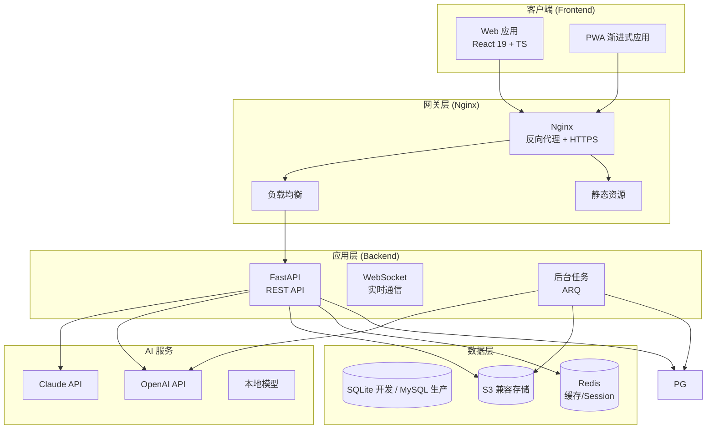

### 1.2 架构分层

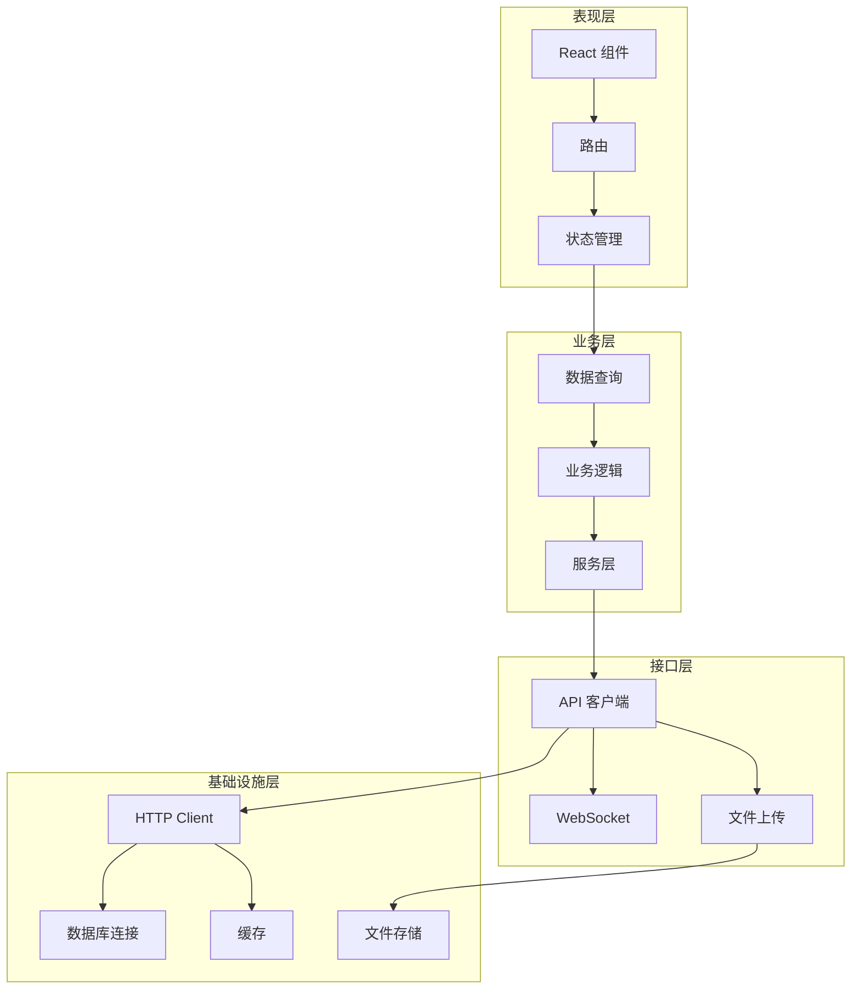

## 2. 技术栈选型

### 2.1 前端技术栈

| 类别 | 技术 | 版本 | 说明 |
|------|------|------|------|
| 框架 | React | 19.x | React Compiler 支持 |
| 语言 | TypeScript | 5.9.x | 强类型支持 |
| 构建 | Vite | 8.x | 极速开发体验 |
| 路由 | TanStack Router | 1.x | 类型安全路由 |
| 状态 | TanStack Query | 5.x | 服务端状态 |
| 状态 | Zustand | 5.x | 客户端状态 |
| 表单 | React Hook Form | 7.x | 表单管理 |
| 验证 | Zod | 4.x | Schema 验证 |
| 样式 | Tailwind CSS | 4.x | 原子化 CSS |
| 组件 | shadcn/ui | 最新 | Radix UI 封装 |
| 图标 | Lucide React | 最新 | 图标库 |
| PDF | PDF.js | 5.x | PDF 渲染 |
| 测试 | Vitest | 4.x | 单元测试 |
| 包管理 | pnpm | 9.x | 高效依赖管理 |

### 2.2 后端技术栈

| 类别 | 技术 | 版本 | 说明 |
|------|------|------|------|
| 框架 | FastAPI | 0.115.x | 高性能 ASGI |
| 服务器 | Uvicorn | 0.32.x | ASGI 服务器 |
| 进程管理 | Gunicorn | 23.x | 生产环境 |
| ORM | SQLAlchemy | 2.0.x | 异步 ORM |
| 数据库 | SQLite (开发) / MySQL (生产) | 3.x / 8.x | 通过 SQLAlchemy 抽象 |
| PostgreSQL | PostgreSQL (可选生产) | 17.x | 另一生产选项 |
| 驱动 | asyncpg | 0.30.x | 异步驱动 |
| 迁移 | Alembic | 1.15.x | 数据库迁移 |
| 缓存 | Redis | 7.x | 缓存/Session |
| 任务队列 | ARQ | 0.24.x | 异步任务 |
| 认证 | PyJWT | 2.x | JWT 令牌 |
| 密码 | Passlib + bcrypt | 最新 | 密码哈希 |
| 验证 | Pydantic | 2.x | 数据验证 |
| 测试 | Pytest | 8.x | 测试框架 |
| 文档 | Swagger | 内置 | API 文档 |

### 2.3 基础设施

| 类别 | 技术 | 说明 |
|------|------|------|
| 容器 | Docker | 应用容器化 |
| 编排 | Docker Compose | 本地开发 |
| 反向代理 | Nginx | 生产环境 |
| 对象存储 | S3 兼容 (MinIO/AWS S3) | S3 标准接口 |
| CI/CD | GitHub Actions | 持续集成 |

## 3. 前端架构

### 3.1 目录结构

```text
frontend/src/
├── main.tsx                    # 应用入口
├── App.tsx                     # 根组件
├── index.css                   # 全局样式
│
├── app/                        # 应用核心
│   ├── router.tsx              # 路由定义
│   ├── providers.tsx           # Provider 组合
│   └── shell.tsx               # 布局组件
│
├── routes/                     # 路由文件（TanStack Router）
│   ├── __root.tsx              # 根路由
│   ├── auth.tsx                # 认证页面
│   └── main/
│       ├── documents.tsx       # 文档列表
│       ├── trash.tsx           # 回收站
│       └── profile.tsx
│
├── features/                   # 功能模块（按领域组织）
│   ├── auth/                   # 认证模块
│   │   ├── api.ts              # API 调用
│   │   ├── schema.ts           # 表单 Schema
│   │   ├── hooks.ts            # 业务 Hooks
│   │   └── components/
│   │       └── auth-page.tsx
│   │
│   ├── layout/                 # 布局模块
│   │   ├── MainLayout.tsx      # 主布局
│   │   └── WorkspaceLayout.tsx # 工作区布局
│   │
│   ├── projects/               # 项目管理
│   │   ├── api.ts
│   │   ├── schema.ts
│   │   ├── hooks.ts
│   │   └── components/
│   │       ├── project-list.tsx
│   │       ├── project-card.tsx
│   │       ├── new-project-dialog.tsx
│   │       └── new-group-dialog.tsx
│   │
│   ├── uploading/              # 上传模块
│   │   ├── api.ts
│   │   ├── schema.ts
│   │   ├── hooks.ts
│   │   ├── store.ts            # Zustand store
│   │   └── components/
│   │       ├── folder-tree.tsx
│   │       ├── file-table.tsx
│   │       ├── file-preview-sheet.tsx
│   │       └── upload-toolbar.tsx
│   │
│   └── coding/                 # 编码模块
│       ├── api.ts
│       ├── hooks.ts
│       ├── store.ts
│       └── components/
│           ├── pdf-viewer.tsx
│           ├── file-tabs.tsx
│           └── highlights-panel.tsx
│
├── shared/                     # 共享资源
│   ├── api/
│   │   ├── client.ts           # API 客户端
│   │   ├── contracts.ts        # 类型定义
│   │   └── errors.ts           # 错误处理
│   │
│   ├── config/
│   │   └── env.ts              # 环境变量
│   │
│   ├── stores/
│   │   ├── session-store.ts    # 会话状态
│   │   ├── ui-store.ts         # UI 状态
│   │   └── index.ts
│   │
│   ├── hooks/
│   │   └── use-auth-guard.ts   # 认证守卫
│   │
│   └── components/
│       ├── loading-overlay.tsx # 全局加载
│       └── page-state.tsx      # 页面状态
│
└── components/                 # 公共组件（shadcn/ui）
    └── ui/                     # UI 组件库
        ├── button.tsx
        ├── card.tsx
        ├── dialog.tsx
        ├── form.tsx
        ├── input.tsx
        ├── table.tsx
        ├── tabs.tsx
        └── ... (更多组件)
```

### 3.2 状态管理架构

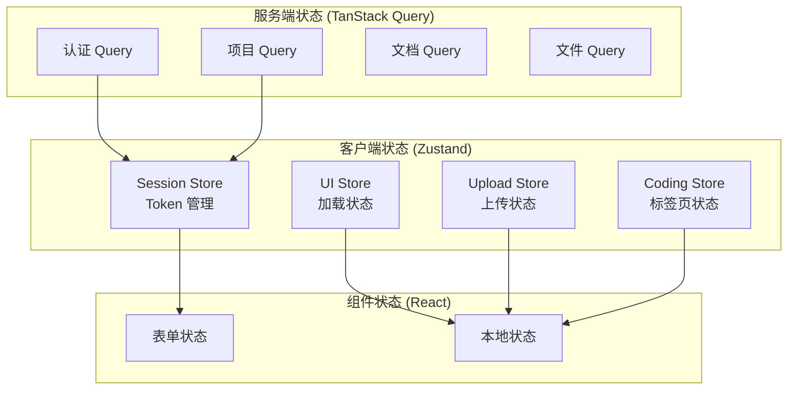

### 3.3 路由结构

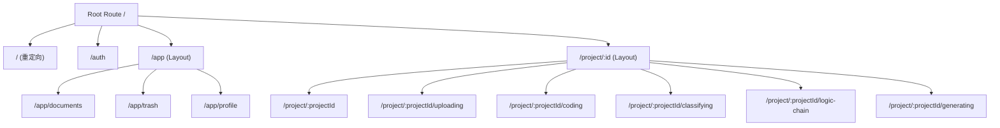

## 4. 后端架构

### 4.1 项目结构

```text
backend/
├── app/
│   ├── __init__.py
│   ├── main.py                 # 应用入口
│   ├── config.py               # 配置管理
│   └── exceptions.py           # 全局异常
│
├── api/
│   ├── __init__.py
│   ├── routes/                 # API 路由
│   │   ├── __init__.py
│   │   ├── account.py          # 认证接口
│   │   ├── projects.py         # 项目接口
│   │   ├── documents.py        # 文档接口
│   │   └── ai.py               # AI 接口
│   │
│   ├── dependencies.py         # 依赖注入
│   ├── response.py             # 响应格式化
│   └── middleware.py           # 中间件
│
├── core/
│   ├── __init__.py
│   ├── security.py             # 安全工具
│   ├── token.py                # JWT 工具
│   ├── database.py             # 数据库连接
│   └── storage.py              # 文件存储
│
├── models/                     # SQLAlchemy 模型
│   ├── __init__.py
│   ├── user.py
│   ├── project.py
│   ├── document.py
│   └── highlight.py
│
├── schemas/                    # Pydantic Schema
│   ├── __init__.py
│   ├── user.py
│   ├── project.py
│   ├── document.py
│   └── common.py
│
├── services/                   # 业务逻辑
│   ├── __init__.py
│   ├── auth.py
│   ├── project.py
│   ├── document.py
│   └── ai.py
│
├── tasks/                      # 后台任务
│   └── __init__.py
│
├── utils/                      # 工具函数
│   └── __init__.py
│
├── tests/                      # 测试
│   ├── __init__.py
│   ├── conftest.py
│   └── api/
│
├── alembic/                    # 数据库迁移
│   ├── env.py
│   └── versions/
│
├── .env.example                # 环境变量示例
├── pyproject.toml              # 项目配置
├── ruff.toml                   # Linter 配置
├── Dockerfile
└── docker-compose.yml
```

### 4.2 请求处理流程

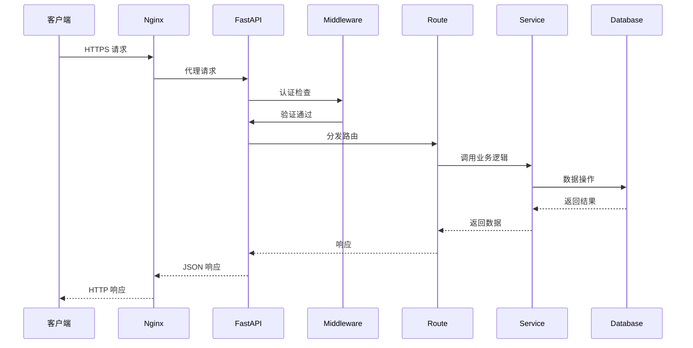

### 4.3 认证流程

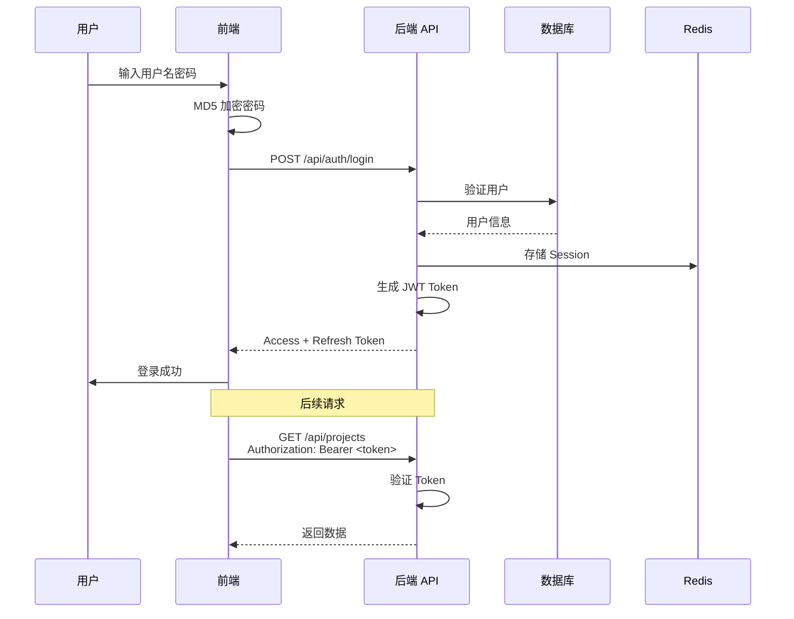

## 5. 数据库设计

### 5.1 核心表结构

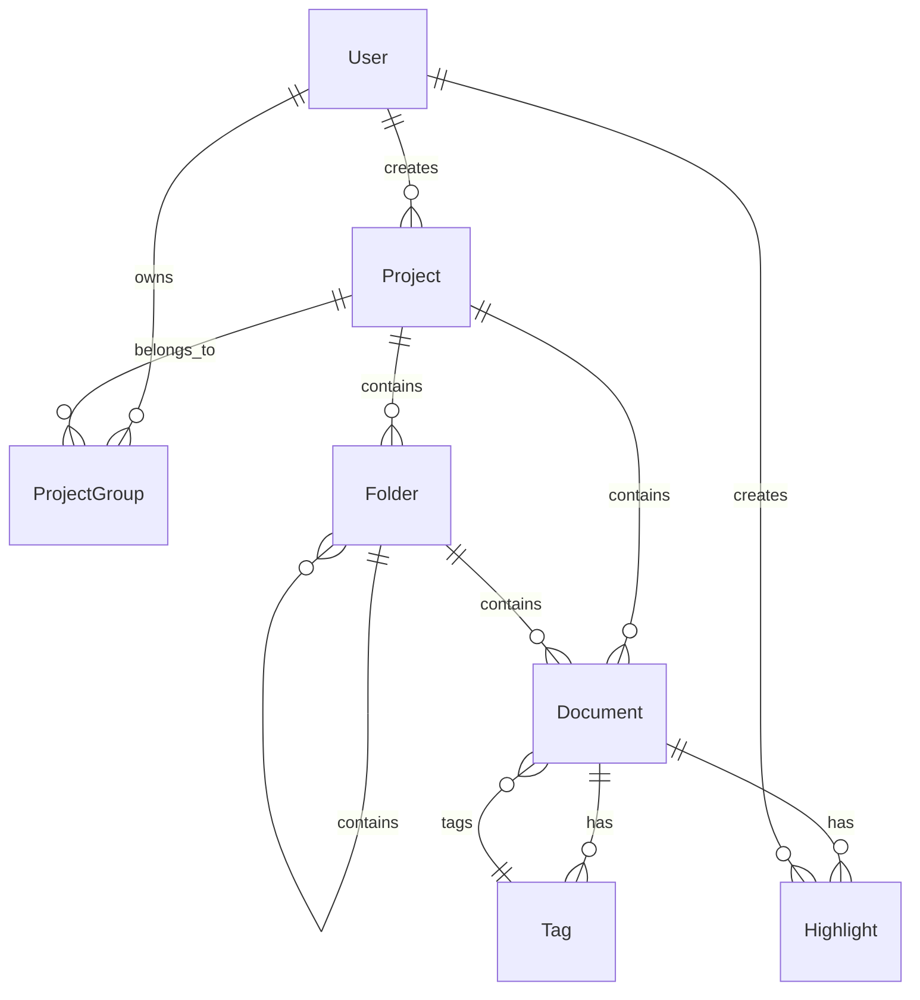

### 5.2 详细表设计

见 [数据库设计](06-database.md) 章节。

## 6. 安全架构

### 6.1 安全层次

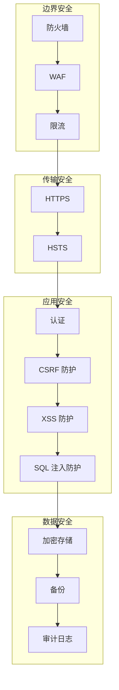

### 6.2 认证方案

| 方案 | 实现 | 说明 |
|------|------|------|
| 访问令牌 | JWT (Access Token) | 短期，有效期 30 分钟 |
| 刷新令牌 | JWT (Refresh Token) | 长期，有效期 7 天 |
| 存储 | localStorage + HttpOnly Cookie | 双存储策略 |
| 传输 | HTTPS | 强制加密传输 |

## 7. 部署架构

### 7.1 开发环境

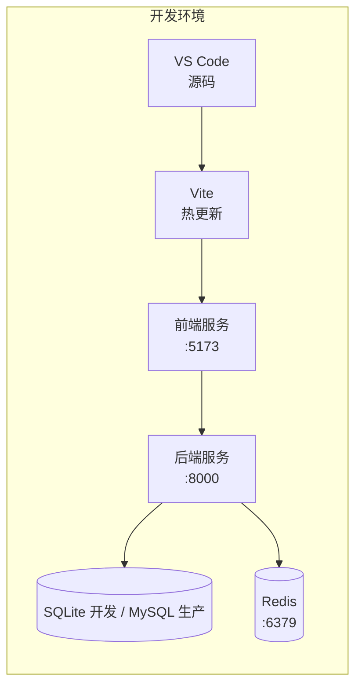

### 7.2 生产环境

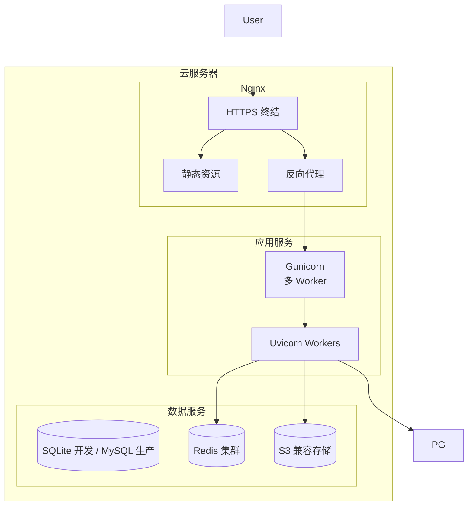

详细部署方案见 [部署运维](10-deployment.md) 章节。

## 8. 监控与日志

### 8.1 日志架构

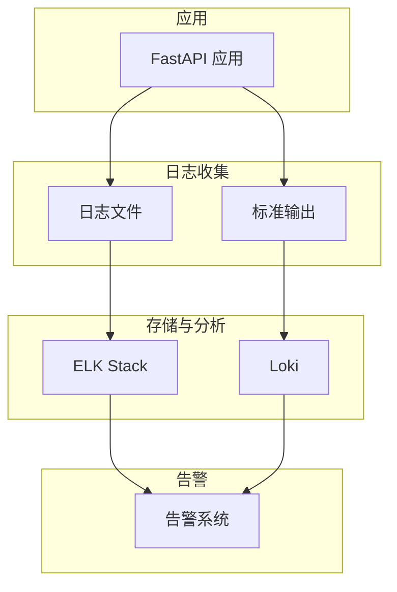

### 8.2 关键指标

| 指标类型 | 监控项 | 告警阈值 |
|----------|--------|----------|
| 可用性 | API 成功率 | < 99% |
| 性能 | API 响应时间 P99 | > 2s |
| 性能 | 页面加载时间 | > 3s |
| 资源 | CPU 使用率 | > 80% |
| 资源 | 内存使用率 | > 85% |
| 资源 | 数据库连接数 | > 80% |

---

*本章节描述了 PaperSage 系统的整体架构设计，包括技术选型、前后端结构、安全方案和部署架构。*
