# 业务流程图

## 1. 核心业务流程

### 1.1 用户登录流程

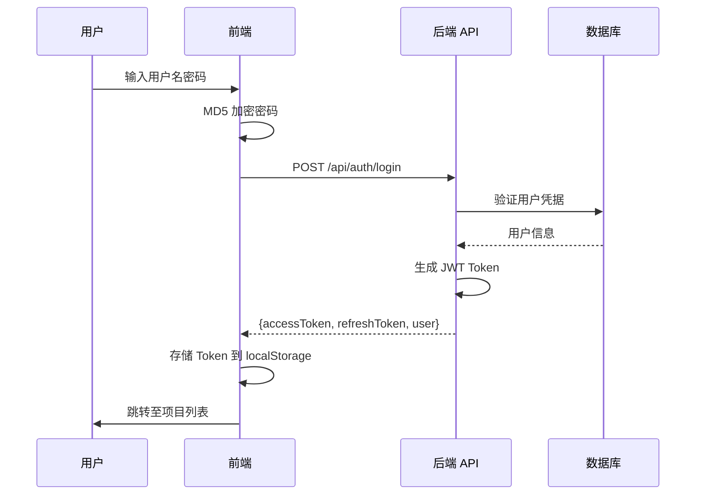

### 1.2 项目创建流程

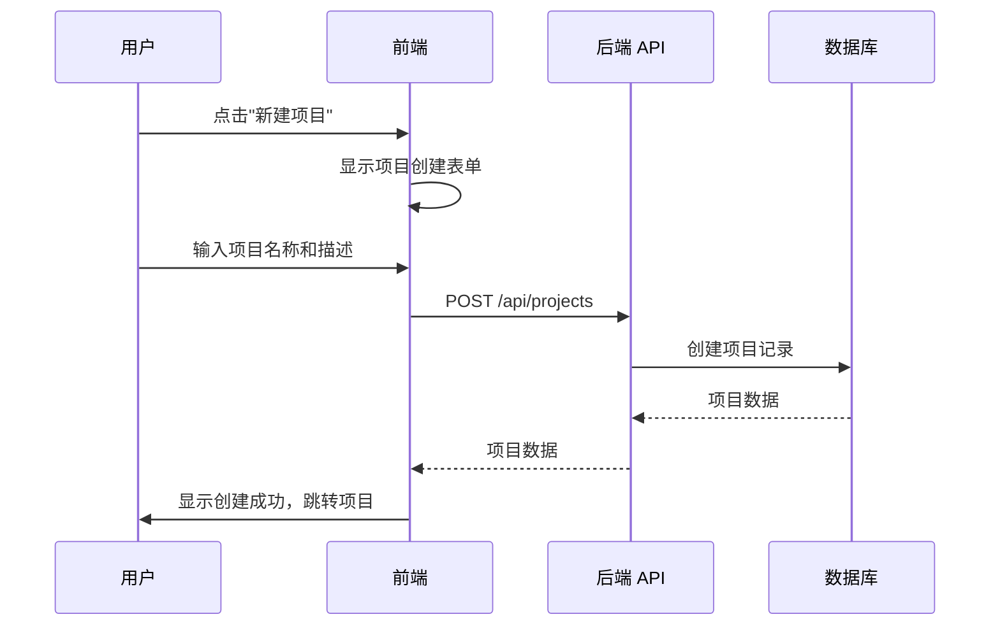

### 1.3 文档上传流程

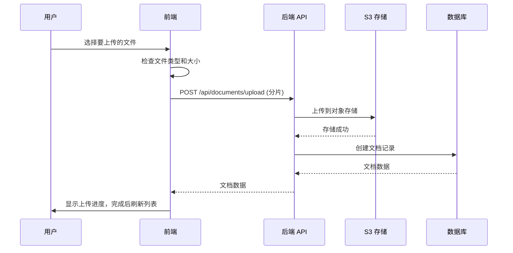

### 1.4 PDF 高亮流程

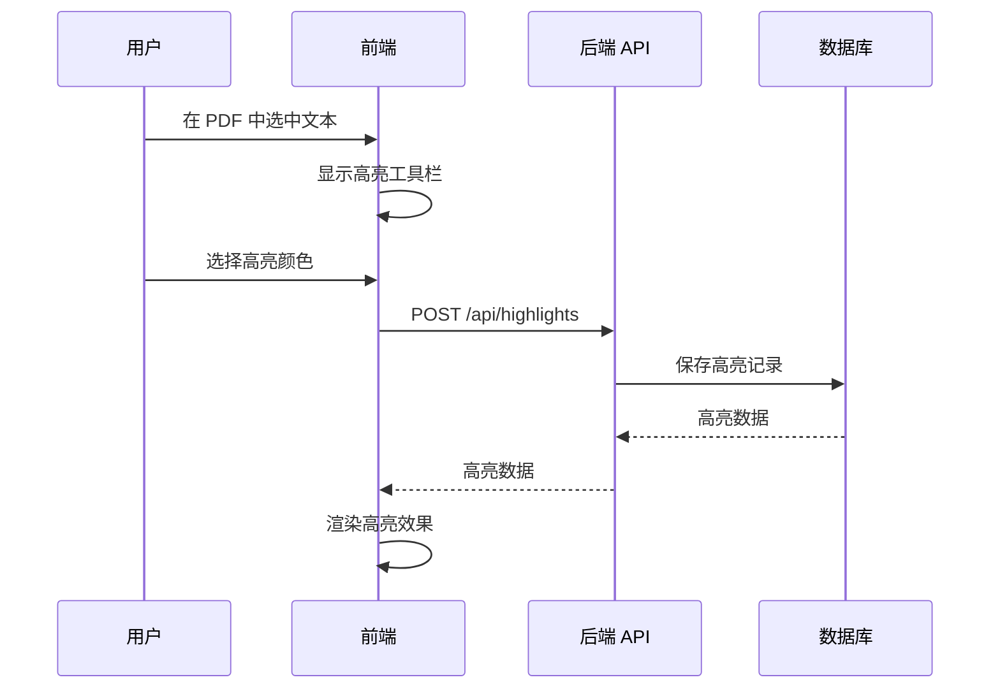

## 2. 用户界面流程

### 2.1 主导航流程

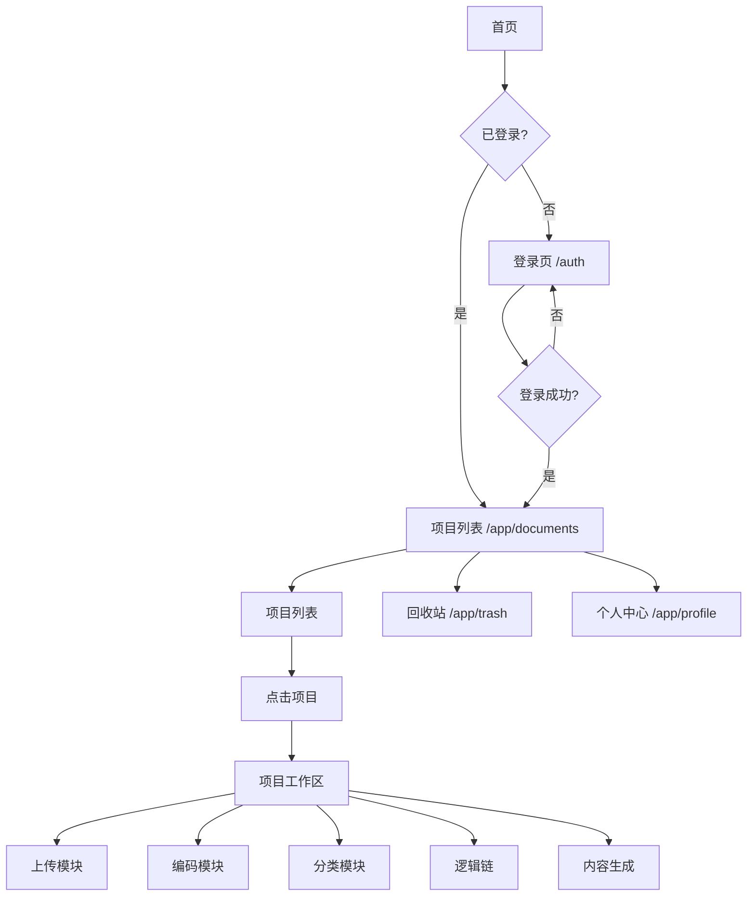

### 2.2 项目工作区流程

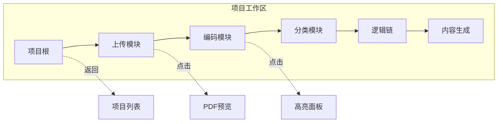

## 3. 数据流图

### 3.1 前端数据流

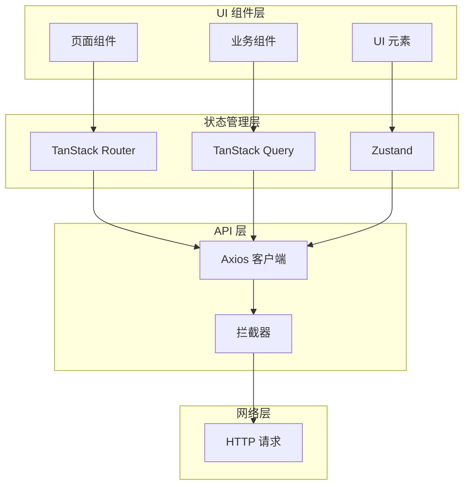

### 3.2 后端数据流

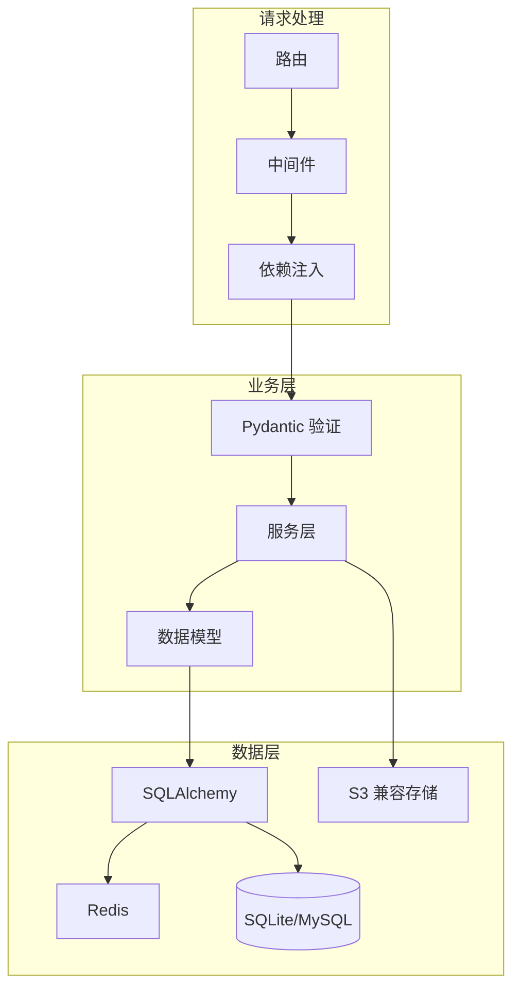

## 4. 状态机

### 4.1 项目状态

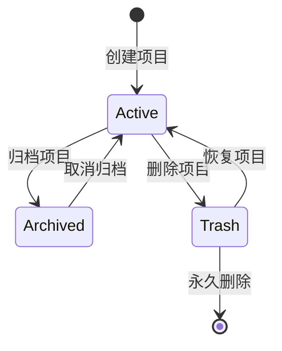

### 4.2 文档状态

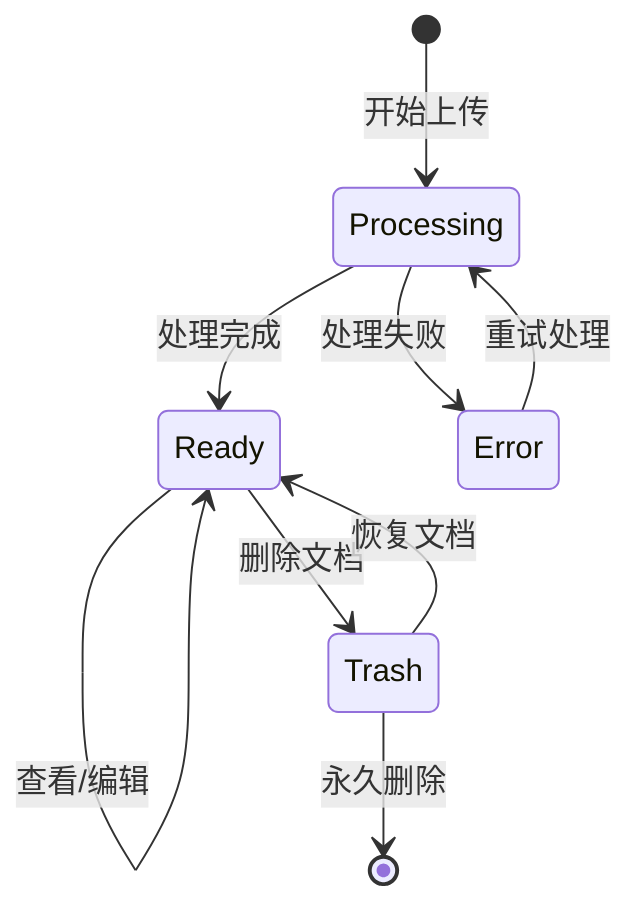

### 4.3 上传状态

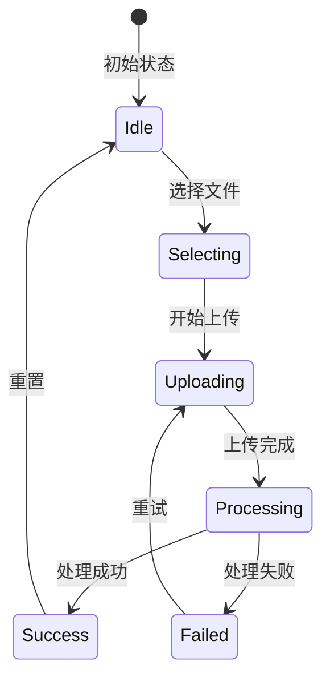

## 5. 时序图

### 5.1 认证流程

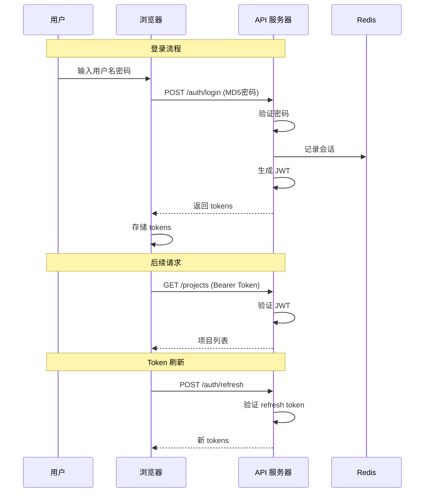

### 5.2 文件上传流程

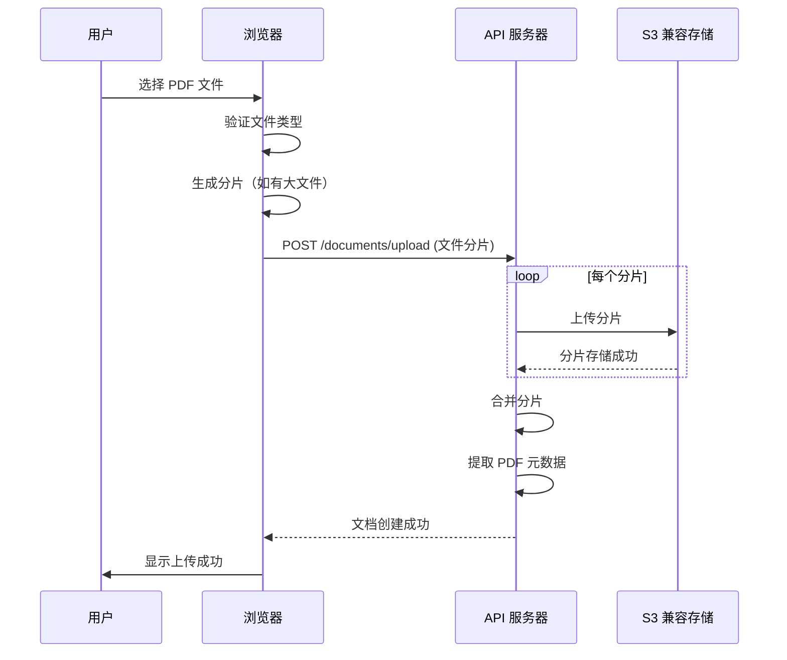

## 6. 架构图

### 6.1 系统架构总览

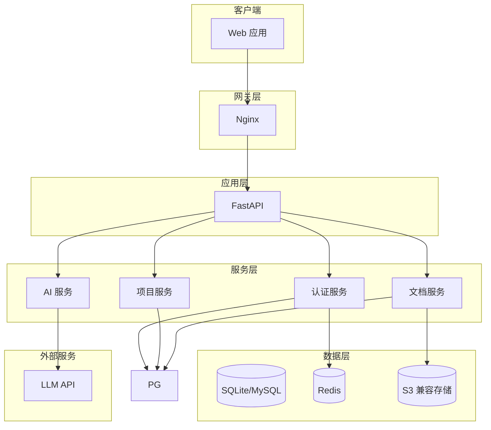

---

*本章节通过多种图表（时序图、流程图、状态机）详细描述了 PaperSage 系统的核心业务流程。*