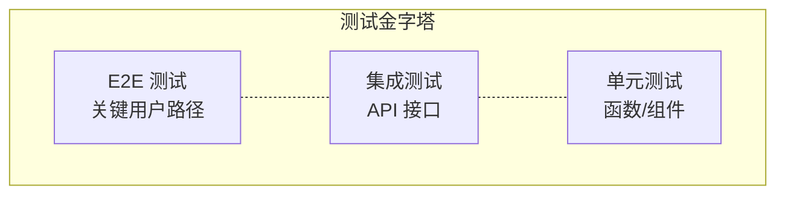

# 测试策略

## 1. 测试目标

### 1.1 质量目标

| 指标 | 目标值 | 说明 |
|------|--------|------|
| 代码覆盖率 | ≥ 80% | 核心业务逻辑 |
| 单元测试通过率 | 100% | 所有单元测试必须通过 |
| 集成测试通过率 | 100% | 所有集成测试必须通过 |
| E2E 测试通过率 | ≥ 95% | 关键用户路径 |
| Bug 修复率 | ≥ 90% | 发布前 P0/P1 Bug |
| 性能指标 | 符合要求 | 见非功能需求 |

### 1.2 测试分层



| 测试类型 | 占比 | 执行时机 | 工具 |
|----------|------|----------|------|
| 单元测试 | 60% | 每次提交 | Vitest / Pytest |
| 集成测试 | 30% | 每次 PR | Vitest / Pytest |
| E2E 测试 | 10% | 发布前 | Playwright |

## 2. 前端测试

### 2.1 测试工具

| 工具 | 用途 |
|------|------|
| Vitest | 单元测试运行器 |
| React Testing Library | React 组件测试 |
| Playwright | E2E 测试 |
| ESLint | 代码规范检查 |
| TypeScript | 类型检查 |

### 2.2 单元测试示例

```typescript
// frontend/src/features/auth/components/auth-page.test.tsx

import { render, screen, fireEvent, waitFor } from '@testing-library/react'
import { describe, it, expect, vi } from 'vitest'
import { AuthPage } from './auth-page'
import { QueryClient, QueryClientProvider } from '@tanstack/react-query'

const queryClient = new QueryClient({
  defaultOptions: {
    queries: { retry: false },
    mutations: { retry: false },
  },
})

const renderWithProviders = (component: React.ReactElement) => {
  return render(
    <QueryClientProvider client={queryClient}>
      {component}
    </QueryClientProvider>
  )
}

describe('AuthPage', () => {
  it('should render login form by default', () => {
    renderWithProviders(<AuthPage />)
    expect(screen.getByText('登录')).toBeInTheDocument()
    expect(screen.getByLabelText('用户名')).toBeInTheDocument()
    expect(screen.getByLabelText('密码')).toBeInTheDocument()
  })

  it('should switch to register mode', () => {
    renderWithProviders(<AuthPage />)
    const switchButton = screen.getByText('没有账号？注册')
    fireEvent.click(switchButton)
    expect(screen.getByText('注册')).toBeInTheDocument()
    expect(screen.getByLabelText('确认密码')).toBeInTheDocument()
  })

  it('should show validation errors for empty fields', async () => {
    renderWithProviders(<AuthPage />)
    const submitButton = screen.getByText('登录')
    fireEvent.click(submitButton)
    await waitFor(() => {
      expect(screen.getByText('用户名至少3个字符')).toBeInTheDocument()
    })
  })
})
```

### 2.3 Hooks 测试

```typescript
// frontend/src/features/projects/hooks.test.ts

import { describe, it, expect, vi, beforeEach } from 'vitest'
import { renderHook, waitFor } from '@testing-library/react'
import { QueryClient, QueryClientProvider } from '@tanstack/react-query'
import { useProjects, useCreateProject } from './hooks'
import * as apiClient from '@/shared/api/client'

vi.mock('@/shared/api/client')

const queryClient = new QueryClient({
  defaultOptions: {
    queries: { retry: false },
    mutations: { retry: false },
  },
})

const wrapper = ({ children }: { children: React.ReactNode }) => (
  <QueryClientProvider client={queryClient}>{children}</QueryClientProvider>
)

describe('useProjects', () => {
  beforeEach(() => {
    queryClient.clear()
  })

  it('should fetch projects successfully', async () => {
    const mockProjects = [
      { id: '1', name: 'Project 1' },
      { id: '2', name: 'Project 2' },
    ]

    vi.mocked(apiClient.default.get).mockResolvedValue({
      data: mockProjects,
    })

    const { result } = renderHook(() => useProjects(), { wrapper })

    await waitFor(() => {
      expect(result.current.isSuccess).toBe(true)
    })

    expect(result.current.data).toEqual(mockProjects)
  })

  it('should handle fetch error', async () => {
    vi.mocked(apiClient.default.get).mockRejectedValue(new Error('Network error'))

    const { result } = renderHook(() => useProjects(), { wrapper })

    await waitFor(() => {
      expect(result.current.isError).toBe(true)
    })
  })
})
```

### 2.4 组件测试

| 组件 | 测试用例 |
|------|----------|
| AuthPage | 登录表单渲染、切换注册模式、表单验证、登录成功跳转 |
| ProjectList | 列表渲染、空状态、加载状态、错误状态 |
| ProjectCard | 渲染项目信息、点击跳转、删除操作 |
| FolderTree | 树形渲染、展开/折叠、点击选择 |
| FileTable | 文件列表渲染、选择、批量操作 |
| PdfViewer | PDF 加载、翻页、缩放 |
| HighlightsPanel | 高亮列表、添加高亮、删除高亮 |

### 2.5 E2E 测试示例

```typescript
// frontend/tests/auth.spec.ts

import { test, expect } from '@playwright/test'

test.describe('Authentication', () => {
  test('should login successfully', async ({ page }) => {
    await page.goto('/auth')

    await page.fill('[name="username"]', 'testuser')
    await page.fill('[name="password"]', 'password123')

    await page.click('button[type="submit"]')

    await expect(page).toHaveURL('/app/documents')
    await expect(page.locator('text=我的项目')).toBeVisible()
  })

  test('should show error for invalid credentials', async ({ page }) => {
    await page.goto('/auth')

    await page.fill('[name="username"]', 'wronguser')
    await page.fill('[name="password"]', 'wrongpassword')

    await page.click('button[type="submit"]')

    await expect(page.locator('text=用户名或密码错误')).toBeVisible()
  })

  test('should redirect to auth when not logged in', async ({ page }) => {
    await page.goto('/app/documents')

    await expect(page).toHaveURL('/auth')
  })
})
```

### 2.6 前端测试配置

```typescript
// frontend/vitest.config.ts

import { defineConfig } from 'vitest/config'
import react from '@vitejs/plugin-react'
import path from 'path'

export default defineConfig({
  plugins: [react()],
  resolve: {
    alias: {
      '@': path.resolve(__dirname, './src'),
    },
  },
  test: {
    globals: true,
    environment: 'jsdom',
    setupFiles: ['./src/test/setup.ts'],
    include: ['src/**/*.test.{ts,tsx}'],
    coverage: {
      provider: 'v8',
      reporter: ['text', 'json', 'html'],
      exclude: ['node_modules/', 'src/test/'],
    },
  },
})
```

## 3. 后端测试

### 3.1 测试工具

| 工具 | 用途 |
|------|------|
| Pytest | 测试运行器 |
| Pytest-asyncio | 异步测试支持 |
| httpx | HTTP 客户端（测试用） |
| Ffaker | 测试数据生成 |
| coverage.py | 覆盖率统计 |

### 3.2 测试结构

```text
backend/tests/
├── __init__.py
├── conftest.py              # 共享 fixture
├── unit/
│   ├── test_auth.py
│   ├── test_projects.py
│   └── test_security.py
├── integration/
│   ├── test_api_auth.py
│   ├── test_api_projects.py
│   └── test_api_documents.py
└── fixtures/
    ├── users.json
    └── projects.json
```

### 3.3 测试 Fixture

```python
# backend/tests/conftest.py

import pytest
import pytest_asyncio
from httpx import AsyncClient, ASGITransport
from sqlalchemy.ext.asyncio import create_async_engine, AsyncSession
from app.main import app
from app.database import Base, get_db
from app.models import User
from core.security import hash_password

# 测试数据库
TEST_DATABASE_URL = "sqlite+aiosqlite:///:memory:"

engine = create_async_engine(TEST_DATABASE_URL, echo=False)


@pytest_asyncio.fixture
async def db_session():
    async with engine.begin() as conn:
        await conn.run_sync(Base.metadata.create_all)

    async with AsyncSession(engine) as session:
        yield session

    async with engine.begin() as conn:
        await conn.run_sync(Base.metadata.drop_all)


@pytest_asyncio.fixture
async def client(db_session: AsyncSession):
    async def override_get_db():
        yield db_session

    app.dependency_overrides[get_db] = override_get_db
    transport = ASGITransport(app=app)
    async with AsyncClient(transport=transport, base_url="http://test") as ac:
        yield ac
    app.dependency_overrides.clear()


@pytest_asyncio.fixture
async def test_user(db_session: AsyncSession):
    user = User(
        id="test-user-id",
        username="testuser",
        email="test@example.com",
        hashed_password=hash_password("password123"),
    )
    db_session.add(user)
    await db_session.commit()
    return user
```

### 3.4 单元测试示例

```python
# backend/tests/unit/test_security.py

import pytest
from core.security import hash_password, verify_password


class TestSecurity:
    def test_hash_password(self):
        password = "test_password"
        hashed = hash_password(password)

        assert hashed != password
        assert len(hashed) > 0

    def test_verify_password_correct(self):
        password = "test_password"
        hashed = hash_password(password)

        assert verify_password(password, hashed) is True

    def test_verify_password_incorrect(self):
        password = "test_password"
        wrong_password = "wrong_password"
        hashed = hash_password(password)

        assert verify_password(wrong_password, hashed) is False
```

### 3.5 集成测试示例

```python
# backend/tests/integration/test_api_projects.py

import pytest
from httpx import AsyncClient


@pytest.mark.asyncio
async def test_create_project(client: AsyncClient, test_user):
    """测试创建项目"""
    response = await client.post(
        "/api/projects",
        json={"name": "新项目", "description": "测试项目"},
        headers={"Authorization": "Bearer test-token"},
    )

    assert response.status_code == 200
    data = response.json()
    assert data["code"] == 200
    assert data["data"]["name"] == "新项目"


@pytest.mark.asyncio
async def test_list_projects(client: AsyncClient, test_user, db_session):
    """测试获取项目列表"""
    # 先创建一个项目
    # ...

    response = await client.get(
        "/api/projects",
        headers={"Authorization": "Bearer test-token"},
    )

    assert response.status_code == 200
    data = response.json()
    assert data["code"] == 200
    assert isinstance(data["data"]["items"], list)


@pytest.mark.asyncio
async def test_delete_project(client: AsyncClient, test_user, db_session):
    """测试删除项目（软删除）"""
    # 先创建一个项目
    # ...

    response = await client.delete(
        "/api/projects/project-id",
        headers={"Authorization": "Bearer test-token"},
    )

    assert response.status_code == 200
    data = response.json()
    assert data["code"] == 200
```

## 4. 测试覆盖要求

### 4.1 前端覆盖率目标

| 模块 | 最低覆盖率 |
|------|-----------|
| 认证模块 (features/auth) | 85% |
| 项目模块 (features/projects) | 80% |
| 上传模块 (features/uploading) | 80% |
| 编码模块 (features/coding) | 80% |
| 共享模块 (shared) | 85% |
| **总计** | **80%** |

### 4.2 后端覆盖率目标

| 模块 | 最低覆盖率 |
|------|-----------|
| 认证服务 (services/auth) | 90% |
| 项目服务 (services/project) | 85% |
| 文档服务 (services/document) | 85% |
| 核心模块 (core) | 90% |
| **总计** | **85%** |

## 5. 测试执行

### 5.1 开发环境测试

```bash
# 前端测试
cd frontend
pnpm test              # 运行所有测试
pnpm test:watch        # 监听模式
pnpm test:coverage     # 生成覆盖率报告

# 后端测试
cd backend
pytest                 # 运行所有测试
pytest --watch         # 监听模式
pytest --cov           # 生成覆盖率报告
```

### 5.2 CI/CD 测试

```yaml
# .github/workflows/test.yml

name: Test

on: [push, pull_request]

jobs:
  test:
    runs-on: ubuntu-latest

    steps:
      - uses: actions/checkout@v4

      - name: Setup Node.js
        uses: actions/setup-node@v4
        with:
          node-version: '20'
          cache: 'pnpm'

      - name: Install frontend dependencies
        run: cd frontend && pnpm install

      - name: Run frontend tests
        run: cd frontend && pnpm test

      - name: Setup Python
        uses: actions/setup-python@v5
        with:
          python-version: '3.12'

      - name: Install backend dependencies
        run: cd backend && pip install -e ".[dev]"

      - name: Run backend tests
        run: cd backend && pytest --cov
```

---

*本章节描述了 PaperSage 系统的测试策略，包括测试目标、测试工具、测试用例和覆盖率要求。*