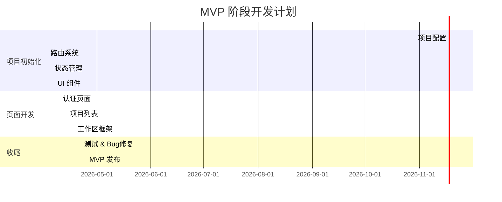
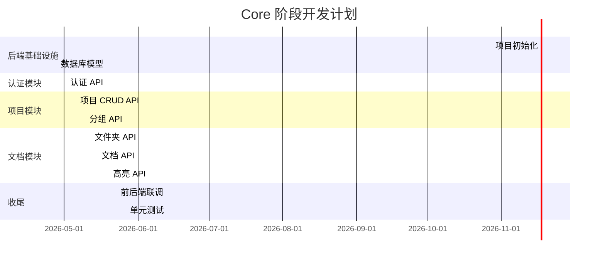

# 开发路线图

## 1. 版本规划

### 1.1 版本概览

| 版本 | 名称 | 目标 | 预计时间 |
|------|------|------|----------|
| v0.1.0 | MVP | 前端基础功能迁移完成 | 2026-04 |
| v0.2.0 | Core | 后端核心 API 实现 | 2026-05 |
| v0.3.0 | Upload | 上传模块完整功能 | 2026-05 |
| v0.4.0 | Coding | 编码标注完整功能 | 2026-06 |
| v0.5.0 | AI Alpha | AI 辅助功能（预览） | 2026-06 |
| v0.6.0 | LaTeX | LaTeX 编辑与渲染 | 2026-07 |
| v1.0.0 | Beta | 完整功能 Beta 版 | 2026-07 |

## 2. MVP 阶段 (v0.1.0)

### 2.1 目标

完成前端基础框架搭建和核心页面迁移。

### 2.2 功能清单

- [x] 项目初始化（Vite + React + TypeScript）
- [x] 路由系统搭建（TanStack Router）
- [x] 状态管理（TanStack Query + Zustand）
- [x] UI 组件库（shadcn/ui）
- [x] 认证页面（登录/注册）
- [ ] 项目列表页面
- [ ] 项目创建/删除功能
- [ ] 项目分组功能
- [ ] 回收站功能
- [ ] 项目工作区框架

### 2.3 里程碑

## 3. Core 阶段 (v0.2.0)

### 3.1 目标

完成后端核心 API 实现，确保前后端联调通过。

### 3.2 功能清单

- [ ] FastAPI 项目搭建
- [ ] 数据库模型定义
- [ ] 用户认证 API（注册/登录/Token 刷新）
- [ ] 项目管理 API（CRUD/分组）
- [ ] 文件夹管理 API
- [ ] 文档管理 API（上传/删除/移动）
- [ ] 高亮管理 API
- [ ] 回收站 API
- [ ] 单元测试（覆盖率 ≥ 80%）

### 3.3 里程碑

## 4. Upload 阶段 (v0.3.0)

### 4.1 目标

完成上传模块完整功能。

### 4.2 功能清单

- [ ] 大文件分片上传
- [ ] 上传进度显示
- [ ] 断点续传
- [ ] 文件预览（PDF）
- [ ] 文件夹树形展示
- [ ] 批量选择操作
- [ ] 文件移动/重命名
- [ ] 文件备注

### 4.3 技术要点

- 前端：分片上传、PDF.js 渲染
- 后端：MinIO 集成、文件处理队列

## 5. Coding 阶段 (v0.4.0)

### 5.1 目标

完成编码标注模块完整功能。

### 5.2 功能清单

- [ ] PDF 渲染优化
- [ ] 文本选择与高亮
- [ ] 高亮颜色管理
- [ ] 批注功能
- [ ] 高亮列表面板
- [ ] 多标签页切换
- [ ] 高亮数据持久化

### 5.3 技术要点

- PDF.js 与 React 集成
- 文本坐标提取
- 高亮渲染优化

## 6. AI Alpha 阶段 (v0.5.0)

### 6.1 目标

实现 AI 辅助功能预览版。

### 6.2 功能清单

- [ ] OpenAI/Claude API 集成
- [ ] 文档摘要生成
- [ ] 论文大纲生成
- [ ] 写作建议
- [ ] 基础润色功能

### 6.3 Prompt 优化

针对以下场景优化提示词：
1. 本科生毕业设计论文
2. 入门级学术小论文
3. 文献综述
4. 研究方法描述

## 7. LaTeX 阶段 (v0.6.0)

### 7.1 目标

实现 LaTeX 文档编辑与编译功能，打通从阅读到输出的完整流程。

### 7.2 功能清单

- [ ] LaTeX 编辑器（Milkdown/TipTap）
- [ ] 公式渲染（KaTeX）
- [ ] 实时编译预览（debounce 触发）
- [ ] PDF 输出与下载
- [ ] 版本历史管理
- [ ] 论文模板（本科论文、学术小论文）
- [ ] AI 内容填入模板
- [ ] 多文件编译（\include）
- [ ] 参考文献支持（bibtex）

### 7.3 技术要点

- TeX Live 引擎（Docker 容器化）
- Celery 异步编译队列
- MinIO PDF 存储

## 8. Beta 阶段 (v1.0.0)

### 8.1 目标

完整功能 Beta 版发布。

### 8.2 功能清单

- [ ] 分类模块
- [ ] 逻辑链模块
- [ ] 完整 AI 辅助功能（含 LaTeX 集成）
- [ ] 学术资源库
- [ ] 用户统计
- [ ] 性能优化
- [ ] 完整测试覆盖
- [ ] 部署文档

## 9. 后续版本规划

### 9.1 v1.1.0 - 体验优化

- 移动端适配
- 主题切换
- 性能优化
- 用户反馈修复

### 9.2 v1.2.0 - AI 增强

- 高级润色功能
- 查重检测
- 格式规范检查
- 论文优化建议

### 9.3 v2.0.0 - 正式版

- 完整功能正式发布
- 商业化准备
- 多租户支持
- API 开放平台

---

## 10. 风险与依赖

### 10.1 技术风险

| 风险 | 影响 | 缓解措施 |
|------|------|----------|
| PDF.js 渲染性能 | 高 | 分页加载、虚拟滚动 |
| 大文件上传稳定性 | 高 | 分片上传、断点续传 |
| AI API 成本 | 中 | 限额控制、缓存 |
| LaTeX 编译安全 | 高 | 容器隔离、内存限制 |
| 前端迁移工作量大 | 中 | 渐进式迁移、优先核心功能 |

### 10.2 项目依赖

| 依赖 | 状态 | 说明 |
|------|------|------|
| React 19 | 可用 | 生产环境可用 |
| Tailwind CSS 4 | 可用 | 新版本，部分生态适配中 |
| shadcn/ui | 可用 | 需适配 Tailwind 4 |
| TanStack Router | 可用 | 稳定版本 |
| FastAPI | 可用 | 生产就绪 |
| PostgreSQL 17 | 可用 | 最新稳定版 |
| TeX Live | 可用 | Docker 镜像可用 |

---

*本章节描述了 PaperSage 系统的开发路线图，包括版本规划、里程碑和技术风险。*