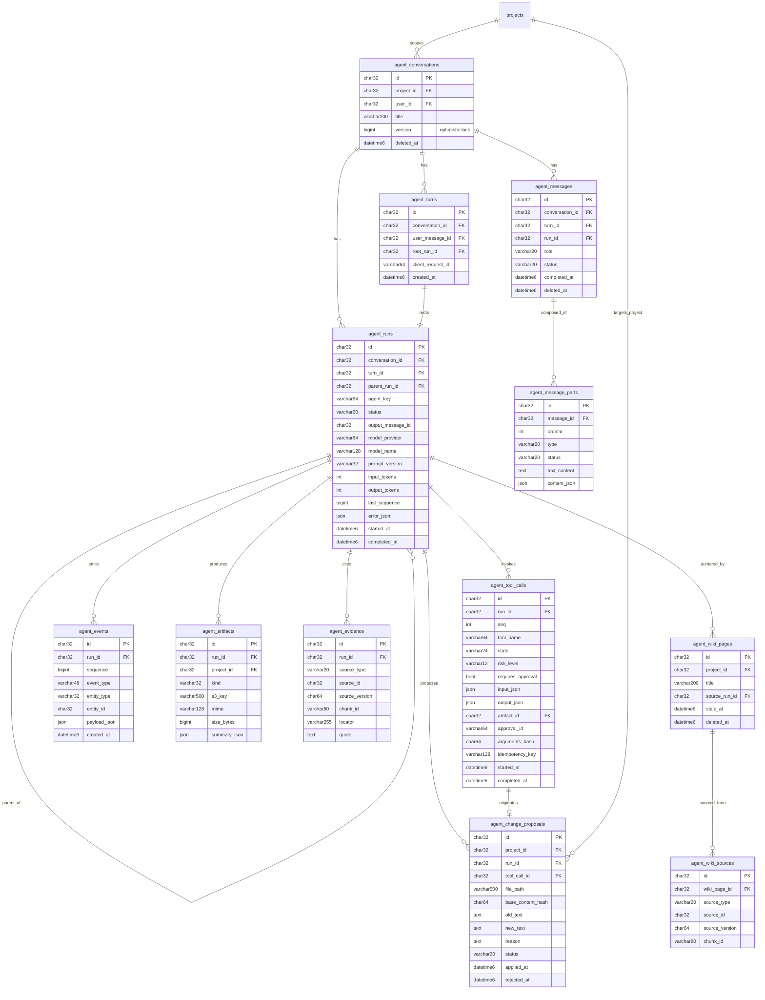

## Context

前置：`data-integrity-refactor`（软删唯一键、删除语义、时钟、索引、RAG 代次）先落地。
参考：《AI 对话应用前后端交互架构研究》（阶段 1–4）+ Vercel AI SDK（Core / Agents / UI 三层概念、UI Message Stream Protocol、AI Elements 组件切分）。
约束：不新增前端依赖；shadcn/ui + Tailwind 4 语义 token；服务层 URL 集中 `api-routes.ts`；envelope `{code,data,info}`；测试覆盖率门槛 ≥80%。

## Goals / Non-Goals

**Goals:**
- Run 成为独立、可查询、可取消、可恢复的业务实体。
- 事件流词汇与 AI SDK UI Message Stream Protocol 完全对齐（前端 reducer 与工具/审批卡片有现成参照）。
- 消息由 Part 组成，UI、执行轨迹、模型上下文三者解耦。
- 工具调用具备完整状态机与审批，审批绑定参数哈希。
- 三类幂等键覆盖重复提交、副作用重复与审批错配。
- agent 不再直接写稿；修改建议经用户确认后由服务端在版本校验下应用。

**Non-Goals:**
- **并行子 agent 的调度与专用树形视图**：v1 交付 Run 树、结果压缩契约与 `activity` 展示（D9），子 agent 串行执行；并行调度与专门的 Run 树可视化视图留待后续。表结构与事件协议已支持并行，不构成阻塞。
- WebSocket 通道（本场景 SSE 足够）。
- 真实多租户 `workspace` 概念（沿用 `projects` 作为作用域）。
- RRF 融合算法修正（属 `data-integrity-refactor` 之外的独立工作）。
- `reasoning-*` part 的展示（模型侧未暴露推理内容时为空）。

## Decisions

### D1 Turn / Run 与接口模式（对齐 PDF §3.2 模式 B）

一次用户提交 = 一个 **Turn**；Turn 创建时同步创建一个 **Run**。Run 独立于 HTTP 连接存在——连接断开不代表 Run 结束。

```
POST   /api/v1/agent/conversations/:id/runs     创建 Turn + Run，立即返回
       body { message:{ clientMessageId, parts:[{type:"text",text}] },
              clientRequestId, expectedThreadVersion }
       → { turnId, runId, userMessageId, streamUrl }
GET    /api/v1/agent/runs/:run_id/events        订阅事件流（SSE）
POST   /api/v1/agent/runs/:run_id/cancel        取消
POST   /api/v1/agent/runs/:run_id/retry         重试（新建 Run，复用 Turn）
GET    /api/v1/agent/conversations              会话列表
POST   /api/v1/agent/conversations              创建会话
GET    /api/v1/agent/conversations/:id/messages 消息 + parts（含已存在的 Run 状态）
POST   /api/v1/agent/tool-calls/:id/approval    审批 { approvalId, decision, argumentsHash, comment }
POST   /api/v1/agent/change-proposals/:id/apply 应用建议（服务端执行替换）
POST   /api/v1/agent/change-proposals/:id/reject
GET    /api/v1/agent/artifacts/:id              大结果下载/预览
```

**BREAKING**：废弃 `POST /projects/:project_id/agent/chat`。前端面板尚未实现，此刻切换代价最低。

### D2 统一事件协议

**决策**：传输层完全对齐 **AI SDK UI Message Stream Protocol**——响应头 `x-vercel-ai-ui-message-stream: v1`，`data:` 行推 JSON part。

| 用途 | part |
|---|---|
| 消息起止 | `start` {messageId} / `finish` / `abort` {reason} / `[DONE]` |
| 文本 | `text-start` / `text-delta` / `text-end`（共享 `id`） |
| 步骤边界 | `start-step` / `finish-step` |
| 工具 | `tool-input-start` / `tool-input-delta` / `tool-input-available`（带 `toolCallId` / `toolName` / `input`） |
| 审批 | `tool-approval-request` {approvalId, toolCallId, reason} / `tool-approval-response` {approvalId, approved} |
| 结果 | `tool-output-available` {toolCallId, output} / `tool-output-denied` {toolCallId} |
| 引用 | `source-document` {sourceId, mediaType, title} |
| 业务自定义 | `data-*`，本项目用 `data-proposal`（建议详情）与 `data-run-status` |
| 错误 | `error` {errorText} |

**内部仍持久化 `agent_events`**（`UNIQUE(run_id, sequence)`）作为事实记录、审计与用量统计来源——PDF §7 的信封字段（`eventId` / `sequence` / `runId` / `parentRunId`）留在服务端，不外露。

**为什么不外露 sequence**：采用 AI SDK 协议即接受它没有顺序号的取舍。断线恢复改走 D6 的路径，代价写在 Risks。

### D3 消息由 Part 组成

`agent_messages` 去掉 `content` 与 `tool_events`，内容落到 `agent_message_parts`：

| 列 | 说明 |
|---|---|
| `ordinal` | 消息内顺序，`UNIQUE(message_id, ordinal)` |
| `type` | `text` / `tool` / `activity` / `approval` / `citation` / `artifact` / `error` |
| `status` | `streaming` / `completed` / `failed` / `denied` |
| `text_content` | 文本类 part 的内容 |
| `content_json` | 结构化 part 的内容（工具入参出参、建议详情等） |

三个数据层解耦（PDF §1.1）：**UI Transcript**（messages + parts，供展示与恢复）、**Execution Trace**（runs / tool_calls / events，供审计与统计）、**Model Context**（每步实际发给模型的上下文，由 Context Builder 从 Transcript 选择、摘要与裁剪，**不直接等于完整消息列表**）。

### D4 工具状态机与审批

**状态机**：只使用实际会被写入的状态——

```
executing → succeeded | failed                        普通工具（框架已校验参数才派发）
executing → awaiting_approval → approved | denied     需用户确认的工具
```

参考架构 §8.1 列的是完整链路 `input_streaming → ready → validating → awaiting_approval → approved|denied → executing → succeeded|failed`，但其中 `input_streaming` / `ready` / `validating` 在本实现里**没有对应的写入点**：参数由 Eino 的工具节点做 schema 校验、工具同步执行，不存在「流式收参」「排队待命」「执行前再校验」三个可观测阶段。为凑齐状态名而写假状态比少几个状态更糟——审计日志一旦含假值就整份不可信。待将来工具改为异步执行（或参数流式到达）时再补这些档位。

**工具定义扩展**（PDF §8.2）：`riskLevel(read|write|destructive)` / `requiresApproval` / `timeoutMs` / `retryPolicy` / `display`。

**审批绑定参数哈希**（PDF §8.3）：审批记录存 `arguments_hash = sha256(file_path, base_content_hash, old_text, new_text)`；调用参数与审批时不一致则审批失效，必须重新请求。

**主 agent 工具集**：4 个读工具 + `compile_project` + `search_references` + **`propose_edit`**（新增）。`write_latex_file` **从主 agent 摘除**，仅作为 `propose_edit` 被批准后的服务端执行路径存在。

**建议确认的执行语义（v1，重要）**：`propose_edit` 执行后立即返回「已生成修改建议，等待用户确认」，**Run 不挂起**——Run 正常走完并 `completed`。建议的应用是独立于 Run 的后续动作。理由是 Eino ADK 的 Runner 是同步循环，实现「挂起—恢复」需要可恢复执行引擎，v1 不引入该复杂度。代价：工具调用会停留在 `awaiting_approval` 直至用户决策或超时，`agent_runs.status` 不反映该等待（由 `data-run-status` part 与建议状态共同表达）。

### D5 三类幂等键（PDF §11.1）

| 键 | 位置 | 防的问题 |
|---|---|---|
| `clientRequestId` | `agent_turns.client_request_id`，`UNIQUE(conversation_id, client_request_id)` | 双击发送 / 网络重试产生两个 Turn 与两次模型调用 |
| `idempotency_key` | `agent_tool_calls.idempotency_key`（`sha256(run_id, seq, tool_name, normalized_input)`），`UNIQUE` | 断线恢复、模型重试或 worker 重启导致工具副作用重复 |
| `approvalId + argumentsHash` | `agent_tool_calls.approval_id` / `arguments_hash` | 用户重复提交审批，或批准后参数被替换 |

**Thread 乐观锁**（PDF §11.2）：`agent_conversations.version`，提交时携带 `expectedThreadVersion`，不匹配返回 409 与最新版本。

**事件一致性**：业务状态与事件在同一事务内写入（PDF §11.3 Outbox 思路的最小实现——v1 不引入独立 Outbox 表，先保证同事务；引入消息队列后再拆）。

### D6 断线恢复

因协议不外露 sequence，恢复路径改为：

1. 客户端加载 **消息快照**（`GET /agent/conversations/:id/messages`，含 parts 与已完成 Run 状态）。
2. 查询该会话是否存在 `status IN (running, awaiting_approval)` 的 Run。
3. 若存在，**重新订阅**该 Run 的事件流；服务端**从头重放该 Run 已产生的 parts**，再继续实时推送。
4. 客户端 reducer 按 part `id` 幂等归并，重放不会产生重复文本。

边界（PDF §7.2）：事件重复 → reducer 幂等吞掉；Run 已结束 → 推完剩余 parts 后关闭流；客户端离线过久 → 只重放最终消息快照与关键事件（`agent_events` 的 `sequence` 使服务端具备将来切换为「增量补拉」的能力）。

### D7 前端状态与渲染（PDF §5）

- **Normalized Store**：`conversations / messages / parts / runs / toolCalls / proposals / lastPartIdByRun` 各自成表，不拼字符串。
- **Event Reducer**：纯函数 `reduceEvent(state, event) → state`，按 part id 归并、按 Run 合并工具状态。
- **UI 三层信息密度**（PDF §5.4）：对话主线（用户 / Assistant / 审批结论）→ 消息内活动（工具卡片 / 进度）→ 执行详情抽屉（步骤、参数、耗时、错误）。默认简洁，按需展开。
- **组件形态参考 AI Elements 的切分**（`Conversation` / `Message` / `PromptInput` / `Tool` / `Confirmation`），**代码自建**——AI Elements 依赖 Next.js 与 `ai` 包，本项目 Vite + 自研后端，不引入。

### D8 数据库设计



关键约束与索引：

```sql
-- 幂等
UNIQUE KEY uq_turn_client_request  (conversation_id, client_request_id)
UNIQUE KEY uq_tool_idempotency     (idempotency_key)
UNIQUE KEY uq_run_sequence         (run_id, sequence)
UNIQUE KEY uq_message_ordinal      (message_id, ordinal)

-- 查询模式
KEY ix_runs_conversation_started   (conversation_id, started_at)
KEY ix_runs_parent                 (parent_run_id)
KEY ix_tool_calls_run_seq          (run_id, seq)
KEY ix_proposals_project_status    (project_id, status)
KEY ix_evidence_run                (run_id)
KEY ix_wiki_sources_page           (wiki_page_id)
```

设计取舍：
- `agent_events.payload_json` 存 part 原文——事件表是**事实记录**，允许冗余，换取审计与将来增量补拉的能力；不做规范化拆解。
- `agent_tool_calls.seq` 替代原「按同名队列配对」的脆弱约定：`UNIQUE(run_id, seq)` 由服务端生成单调序号，配对不再依赖工具名。
- `agent_artifacts.s3_key` 复用现有 `storage` 抽象；大结果（如文献全文）不再塞进消息与模型上下文（PDF §8.5）。
- 子 agent 复用 `agent_runs.parent_run_id` 自引用，`main → search_references` 成为 Run 树，但 v1 不承诺并行。
- `agent_evidence.source_id` 为多态引用（document / latex_file / wiki），DB 层不设 FK，由应用层保证；`(source_type, source_id)` 建索引。

### D9 多 Agent 架构

**形态**：**Supervisor + 专业子 agent**，子 agent 以工具形式挂载（PDF §9.1「Subagent as Tool」）。用户始终面对单一 Assistant；子 agent MUST NOT 成为新的顶层对话发言者。仅当对话控制权、业务身份与可用工具都发生实质变化时才使用 Handoff（PDF §9.2）——本项目 v1 无此场景。

**实现基座**：主 agent 用 Eino prebuilt **`DeepAgent`**（`adk/prebuilt/deep`），而非裸 `adk.NewChatModelAgent`：

- 子 agent **声明式**放进 `deep.Config.SubAgents`，由 DeepAgent 生成 `task` 工具完成编排；
  **不手工包 `adk.NewAgentTool`**——框架已有该能力，自己再包一层就是重复造轮子。
- `ToolsConfig.EmitInternalEvents: true` 使子 agent 的事件带 `AgentEvent.AgentName` 流出。
  **「事件来自哪个 agent」由框架给在事件上**，因此不去解析 `task` 工具的参数猜目标子 agent。
- 事件按 `AgentName` 分流：子 agent 的事件写进**它自己的子 Run**（独立 `sequence` / `events` / `tool_calls`）留档，
  但**不计入主回答**；主 agent 的事件才进入面向用户的 part 流与终答。这是「子 agent 不成为第二发言者」在代码里的落点。
- 不设 `Backend` / `Shell`（不注册文件系统与命令执行工具）、不设 `MaxIteration`：
  不凭空增加能力，也不凭空设上限。
- Eino 另有 `NewParallelAgent` / `NewSequentialAgent` / `NewLoopAgent`（基于 agent transfer 的 workflow agents），
  但其源码标注 **NOT RECOMMENDED**（「full context sharing, which has not proven to be more effective empirically」），
  本项目不采用。

**Agent 拓扑**（按产品依赖增补，**架构本身不再变动**）：

```
main（论文写作助手，Supervisor）
├── search_references（检索专家：rag_search / wiki_read / wiki_write）   ← v1 已实现
├── compile_project / 4 个读工具 / propose_edit                          ← v1 主 agent 自身工具
├── （后续）compare_literature（文献比较）   ← 依赖 LiteratureNote / LiteratureComparison
└── （后续）review_chapters（跨章节检查）     ← 依赖 ChapterPlan / 规范库
```

三个子 agent 恰好对应 `docs/project/12-ai-writing-design.md` §10 P1 的交付主线，因此**增加子 agent 不需要改表、改协议或改前端**——这是本决策的全部价值。

**Run 树**：每次子 agent 调用创建一个子 Run，`agent_runs.parent_run_id` 指向父 Run；`agent_key` 标识 agent 身份（`main` / `search_references` / …）。子 Run 拥有自己的 `agent_tool_calls` 与 `agent_events`，`sequence` 在各自 Run 内独立。

**结果压缩**：UI 与审计保留子 agent 的完整过程（在子 Run 的 parts / tool_calls / events 里）；
交给父 agent 上下文的只是子 agent 的**最终结论**（即 `task` 工具的返回）。

**不给子 agent 规定固定的输出模板**。曾写过一版「必须输出【结论】【依据】【不确定】三段」，那是错的：
等于把父 agent 的消费方式写死进子 agent 的提示词，换个父 agent 或换个问题就得重写。压缩靠**结构**实现
（只回结论、过程留在子 Run），不靠格式约定；质量约束（注明出处、不编造）留在提示词里即可。

**上下文隔离**：每个 Run 由 Context Builder 独立构造模型上下文，父 agent 的上下文 MUST NOT 装载子 agent 的完整历史（否则多子 agent 会迅速撑满父上下文——PDF §9.5 的核心动机）。

**展示语义**：子 agent 活动作为父 Assistant 消息内的 `activity` part 呈现，可展开查看 Run 树；并行执行时展示为任务面板（「正在并行处理 N 个任务」），MUST NOT 渲染成多个 agent 互相发言（PDF §9.3 的风险提示）。

**并行**：v1 串行；子 Run 表结构与事件协议已支持并行（独立 `sequence`、独立 events、独立 `last_sequence`），调度策略留待后续变更。

## Migration Plan

1. 依赖 `data-integrity-refactor` 已落地（软删唯一键、时钟、`deleted_seq`）。
2. 新增 9 张表 + 3 张表改造（`agent_conversations` 加 `version`；`agent_messages` 去 `content`/`tool_events`、加 `turn_id`/`run_id`/`status`/`completed_at`；`agent_wiki_pages` 加 `source_run_id`/`stale_at`）。
3. 数据迁移：现有 `agent_messages` 每条 `content` 转为一条 `text` part；`tool_events` JSON 数组逐项转为 `tool` part。均为演示数据，一次性脚本完成并断言 parts 数 = 消息数。
4. 双方言迁移 + `schema/tables/*.sql` 真相源 + `AllModels()`（SQLite AutoMigrate）三处登记。
5. 迁移号：`0011` 归 `writing-workbench-foundation`，`0012` 归 `data-integrity-refactor`，本变更取 `0013`（按落地顺序调整）。
6. 回滚：`down` 删除新表并恢复 `agent_messages` 旧列（旧列内容可由 parts 重建，需在 down 中实现反向聚合）。

## Risks / Trade-offs

- [协议不含 sequence，重放整段 Run 的开销随 Run 变长而增长] → v1 的 Run 通常是数十秒内的 ReAct 循环，重放可接受；`agent_events.sequence` 与 `agent_runs.last_sequence` 已就位，将来可平滑切到增量补拉。
- [Run 不挂起导致「审批中」状态在两处表达] → `data-run-status` part + 建议状态共同呈现；文档明确 v1 语义，避免误读为 Run 仍在执行。
- [`agent_messages` 去 `content` 是破坏性契约变更] → 前端面板尚未实现，仅需同步更新现有契约测试；`GET .../messages` 的响应改为 parts 数组。
- [表数量增长快（9 张）] → 按 tasks 的阶段分批落地，每批自带迁移与测试；`agent_artifacts` / `agent_evidence` / `agent_wiki_sources` 排在后段，前段可独立验收。
- [Eino ADK 的事件模型与 AI SDK part 词汇需适配层] → 新增 `agent/protocol.go` 专责转换，禁止在 handler 内直接拼 part。
- [流式写入频率] → 遵循 PDF §6.3：增量先入缓冲与 `agent_events`，按检查点写 part，part 完成后一次写规范内容；**不得**每 token UPDATE。

## Resolved Questions

- **写权限**：agent 不写盘，只产出建议；写入由用户确认后服务端执行（评审 2026-10-04）。
- **会话删除**：软删会话，运行记录保留（`data-integrity-refactor` 承载）。
- **协议词汇**：完全对齐 AI SDK UI Message Stream Protocol，包括响应头（评审 2026-10-04）。
- **采纳阶段**：参考架构阶段 1–4；阶段 5（子 agent 展开）不做，仅保留 `parent_run_id`。
- **是否引入 AI Elements / `ai` 包**：否。参考组件切分与状态命名，代码自建。
- **是否使用外部 agent harness**（AI SDK `HarnessAgent` 对应的 Claude Code / Codex / Pi）：否。该抽象位由 **Eino ADK 的 `NewChatModelAgent` + `Runner`** 承担——loop、context management、stopping conditions 与 model provider 解耦，正是 harness 的角色。不引外部 harness 的三条理由：① 它们内置编程工具集（bash / git / 文件编辑），与文献检索和 LaTeX 版本安全的领域不匹配；② 循环跑到进程外会使 §7 要求的权限、基准版本与幂等校验失去可拦截点；③ 核心循环外包会让本项目的工程工作量失去依据（`docs/project/12-ai-writing-design.md` §10）。
  由此派生一条实现纪律：**Eino 的事件类型不得泄漏到 `internal/agent/protocol.go` 之外**，否则「循环可替换」只是名义上的。
