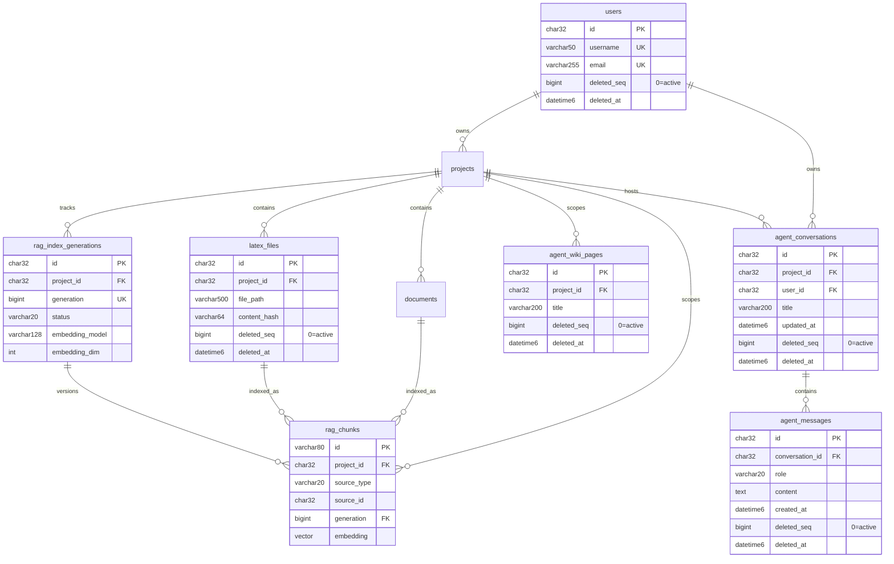

## Context

数据层评审（2026-10）发现的缺陷集中在「逻辑删除 × 唯一约束 × 多方言」三者交界处，且全部落在本次 AI 工作台重构要复用的表上。本变更只做正确性修复与结构补齐，不新增用户可见功能。

约束：三方言并存（PostgreSQL / MySQL(含 TiDB) / SQLite AutoMigrate），SQL-first（`server/schema/tables/*.sql` 为真相源），软删除是既有约定（`gorm.DeletedAt`），存量数据不得破坏。

## Goals / Non-Goals

**Goals:**
- 消除「删除后无法重建同名资源」这一已确认缺陷。
- 消除删除语义在表 / 模型 / 代码三层的不一致。
- 时间戳在三方言下行为一致，业务时间一律由应用层写入。
- 索引与现有查询模式匹配。
- 检索索引具备可表达、可切换的代次。

**Non-Goals:**
- RRF 融合算法本身的修正（`docs/project/12-ai-writing-design.md` §6.2 已登记，属独立工作）。
- 证据身份与版本、wiki 溯源表（依赖 `agent_runs`，归后续变更）。
- 稿件快照与版本回退。
- 把 MySQL `datetime(6)` 改为带时区类型（涉及存量数据与契约兼容，代价大于收益；改用「应用层统一写 UTC」达到同等效果）。

## Decisions

### D1 唯一约束引入 `deleted_seq`

**问题**：`latex_files` 声明 `UNIQUE (project_id, file_path)` 并走软删除，而 `findByPath` 受 GORM 软删过滤看不到已删行，`CreateFileBinary` 遂直接 `Create`，撞唯一键。删除 `main.tex` 后无法重建 `main.tex`。

**决策**：受影响表增加 `deleted_seq BIGINT NOT NULL DEFAULT 0`，唯一键改为包含该列。活跃行取 `0`；删除时写入单调非零值（unix 微秒）。应用层新增软删入口统一写入。

**备选与否决理由**：
- 部分唯一索引（PG `WHERE deleted_at IS NULL`）→ MySQL/TiDB 不支持，否决。
- 把 `deleted_at` 直接纳入唯一键 → MySQL 唯一索引中 NULL 不去重，活跃行反而失去约束，否决。
- 软删时改写唯一列（`main.tex` → `main.tex.deleted.1712...`）→ 破坏历史可读与审计，否决。
- 改为硬删除 → 破坏「用户资产一律软删」的统一约定。**经核查，回收站目前只覆盖项目**（`GET /projects/trash`、`POST /projects/trash/project/:id/restore`，trash 项 `type` 恒为 `project`），`latex_files` / `documents` **并无恢复路径**，因此"软删是为了恢复"这一理由对文件并不成立。仍保留软删是因为：D2 已确立用户资产统一软删的分层约定，为一表开硬删例外会让约定失去意义，且放弃将来增加文件级恢复的可能。此事实已核对并记录，避免后续以错误理由维护该决策。

**实现要点**：GORM 的软删由 `gorm.DeletedAt` 的 `DeleteClauses` 生成 `UPDATE ... SET deleted_at`。要同时写 `deleted_seq`，需自定义软删时间类型（实现 `QueryClauses`/`DeleteClauses`），使 DELETE 语句同时赋值两列。**不得**依赖 `BeforeDelete` 钩子里再发一条 UPDATE（会递归且非原子）。实施时先补一条回归用例：创建 → 删除 → 同名重建 → 断言成功。

**受影响唯一键**：

| 表 | 唯一键 | 本变更处理 |
|---|---|---|
| `latex_files` | `(project_id, file_path, deleted_seq)` | ✅ 修复（已回归复现的缺陷） |
| `agent_wiki_pages` | `(project_id, title, deleted_seq)` | ✅ 同机制覆盖 |
| `users` | `username` / `email` | ⚠️ **不在本变更内**，理由见下 |

**`users` 为何排除**（已核实，非疏漏）：GORM 的 `uniqueIndex` tag 中，一个字段**只能属于一个索引**——tag 值里首个逗号之后按参数解析，且重复的 `uniqueIndex` 键在 map 解析时会被覆盖。`users` 的 `username` 与 `email` 是两个独立唯一索引，都要包含 `deleted_seq`，因此在 AutoMigrate 路径（SQLite，即测试与开发环境）无法用 tag 表达；若强行表达，只能让其中一个索引漏掉 `deleted_seq`，半修反而更隐蔽。
另一面：**当前代码库没有任何删除用户的路径**（既无接口也无 service 方法），该陷阱纯属假设。按「不为假想需求扭曲 schema」暂不处理，改为在 `users` 表上加注释记录，待用户注销/删除功能立项时随该变更一并解决。此限制是 GORM 表达能力所致，SQLite 与 PG/MySQL 一致，不引入方言差异。

### D2 删除语义分层

**决策**：删除语义按数据性质四分（下表由漂移检查逐表核对得出），并写入 `CLAUDE.md`：

| 类别 | 对象 | 语义 | 依据 |
|---|---|---|---|
| 用户资产 | `projects` / `project_groups` / `folders` / `documents` / `latex_files` | **软删除** | 回收站目前覆盖项目；文件保留将来做恢复的可能 |
| 会话记录 | `agent_conversations` / `agent_messages` | **软删除** | 删除会话不销毁实验与审计证据 |
| 派生索引 | `rag_chunks` / `agent_wiki_pages` | **硬删除** | 可由来源重建；§6.3 对来源变更的处理是「标记过期」而非删除 |
| 基础设施 | `refresh_tokens` / `verification_tokens` / `system_settings` / `user_settings` | **硬删除** | 无恢复需求 |

**动作**：真相源里声明了 `deleted_at` 而模型未映射的表，按上表二选一——属于用户资产或会话记录的**补齐模型映射**；属于派生索引或基础设施的**从真相源移除该列**（遗留死列会让软删语义悬空：GORM 不感知该列，查询会返回已删行、`Delete()` 退化为物理删除）。

**修复**：`AgentConversation` / `AgentMessage` 补齐软删字段（表已有 `deleted_at` 列，模型未映射）。`deleteConversation` 由裸 SQL 硬删改为 GORM 软删，并在**同一事务**内软删该会话的消息——软删不触发 `ON DELETE CASCADE`，不能依赖级联。

`agent_messages` 不可变（无 `updated_at` 列），故不复用 `BaseModel`，改用不含 `UpdatedAt` 的软删基类。

### D3 时间戳统一

**决策**：业务时间一律由应用层以 UTC 写入（GORM `autoCreateTime` / `autoUpdateTime`）。数据库默认值与 `ON UPDATE CURRENT_TIMESTAMP` 仅作兜底，不作为业务时钟。移除裸 `now()`（`agent/service.go` 的 `UPDATE agent_conversations SET updated_at = now()` 在 SQLite 下静默失败，错误被丢弃）。

约定：`datetime(6)` 存储值一律为 UTC，序列化沿用 `dto.JSONTime`（Python isoformat 兼容契约不变）。

### D4 索引补齐

| 表 | 新增索引 | 依据 |
|---|---|---|
| `agent_conversations` | `(project_id, user_id, updated_at)` | 会话列表 `WHERE project_id AND user_id ORDER BY updated_at DESC LIMIT 50` |
| `agent_messages` | `(conversation_id, created_at)` | 历史消息 `WHERE conversation_id ORDER BY created_at` |

### D5 检索索引代次

**问题**：`rag_chunks` 无 generation，§6.3 要求的「建立新索引代次—校验—切换活动代次」无从表达；嵌入模型更换后无法区分新旧向量。

**决策**：
- `rag_chunks` 增 `generation BIGINT NOT NULL DEFAULT 1`，索引 `(project_id, generation)`。
- 新增 `rag_index_generations`：`(id, project_id, generation, status(building|active|superseded|failed), embedding_model, embedding_dim, chunk_count, created_at, activated_at)`；`UNIQUE (project_id, generation)`，`INDEX (project_id, status)`。
- 检索只命中该项目 `status = active` 的代次；写入侧按「建新代次 → 校验 → 切换 active」推进，失败代次保留可重试、旧代次可回查。

本变更交付**表结构与状态流转**；RRF 融合算法修正不在本变更。

## 数据模型（受影响部分）



唯一键变更（MySQL 方言）：

```sql
-- users
UNIQUE KEY uq_users_username (username, deleted_seq)
UNIQUE KEY uq_users_email    (email, deleted_seq)
-- latex_files
UNIQUE KEY uq_project_file_path (project_id, file_path, deleted_seq)
-- agent_wiki_pages
UNIQUE KEY uq_wiki_project_title (project_id, title, deleted_seq)
```

### D6 RAG 表的三方漂移与 SQLite 建表缺口

**已核实的漂移**（`agent_wiki_pages`，三处声明互不一致）：

| 列 | Go 模型 `rag.WikiPage` | `schema/tables/agent_wiki_pages.sql` | `0005_rag.up.sql`（PG/MySQL） |
|---|---|---|---|
| `meta` | ✅ 声明并由 `UpsertWiki` 写入 | ✗ | ✗ |
| `deleted_at` | ✗ | ✅ | ✗ |

**后果**：
- `UpsertWiki` 设置 `page.Meta` 后 `Save`（`internal/rag/wiki.go:44`）→ 在 PG/MySQL 上必然命中「列不存在」→ 子 agent 的 `wiki_write` 工具**在生产环境不可用**。
- `schema/tables` 声明了 `deleted_at`，而迁移与模型都没有 → 真相源自身失真。
- SQLite 路径下 `rag_chunks` / `agent_wiki_pages` **不会被创建**：`store.AllModels()` 未注册 rag 模型（`rag` 依赖 `store`，反向注册成环），`store.Open` 的 SQLite 分支只 AutoMigrate `AllModels()`，`rag.NewStore` 也不建表。本地开发与 E2E 的 RAG 因此静默失效（索引失败仅记日志，不阻断入库）。
- 测试全绿的原因：`internal/agent/agentic_search_test.go:46` 直接 `AutoMigrate(&rag.IndexedChunk{}, &rag.WikiPage{})`，按 **Go 模型**建表，掩蔽了与迁移的差异——正是 SQL-first + golang-migrate 要避免的失败模式。

**决策**：
1. 以迁移与 `schema/tables/*.sql` 为真相源，**把 `meta` 补进 DDL**（模型已在用，承载 wiki 页元信息）。
2. `agent_wiki_pages` 归入「派生索引」，**硬删除**：从真相源移除 `deleted_at`，模型不引入 `deleted_seq`，`UNIQUE(project_id, title)` 保持原样。
   理由：wiki 页是 §6.3 所述**派生笔记**（可由检索重建），来源变更以「标记过期」处理而非删除；既然硬删，已删行就不会占位唯一键，`deleted_seq` 在本表成为多余机制——比先前的设计更简单。（此项推翻本变更早期草案中「wiki 也用 `deleted_seq`」的判断。）
3. 消除 SQLite 建表缺口：新增 **`store.RegisterModels(...)` 注册口**，由 `rag` 包在 `init()` 注册自己的模型，`AllModels()` 合并注册项。既不成环，也不必在 `store` 重复声明 rag 结构（原注释的做法会造成第二份真相源）。
4. 新增**漂移检查测试**：逐表比对 Go 模型与 `schema/tables/*.sql` 的列集合，不一致即失败——把这次靠人眼发现的问题变成机器可拦。

## Migration Plan

1. 加列（带默认值，不锁表风险低）；存量已软删行回填 `deleted_seq = UNIX_TIMESTAMP(deleted_at) * 1000000`。
2. 重建唯一键（先删旧约束再加新约束）。
3. 加索引与 `rag_index_generations` 表；`rag_chunks.generation` 存量行默认 `1`，并为每个已有 `project_id` 补一条 `generation = 1, status = 'active'` 的代次行。
4. 双轨登记：`server/migrations/{postgres,mysql}` 双方言 + `schema/tables/*.sql`（真相源）+ `store.AllModels()`（SQLite AutoMigrate）。
5. 回滚：`down` 反向执行；新列与新表在旧代码下被忽略，无破坏性。
6. 迁移号：`0011` 已被 `writing-workbench-foundation` 占用，本变更按落地顺序取后续号（默认 `0012`）。

## Risks / Trade-offs

- [自定义软删类型改动 `store` 基座，影响面广] → 先落回归用例（删后重建、反复删建、软删行不参与查询）再改基座；`AllModels()` 覆盖的所有表跑通。
- [`deleted_seq` 回填与时间精度] → 迁移中用 `deleted_at` 派生；同表同一时刻多条软删行会撞唯一键的极端情况，改用「时间戳 + 行号」派生并在迁移中断言唯一。
- [SQLite 无 `vector` / `json` 方言差异] → SQLite 走 AutoMigrate 兜底，代次表结构保持一致，检索向量在 SQLite 路径下退化为内存实现（既有行为）。
- [代次切换的并发] → 同一项目同时只允许一个 `building` 代次；切换 `active` 用条件更新（`WHERE status = 'building'`）保证幂等。

## Resolved Questions

- **会话删除是否销毁运行记录** → 不销毁。会话与消息软删，运行记录保留（评审 2026-10-04）。
- **wiki 溯源表的归属** → 该表引用 `agent_runs`，归后续 agent 变更，本变更不建。
- **是否统一改为带时区时间类型** → 否，改用应用层统一写 UTC。
